# Studio Audio Pipeline

CZABA Store-ის Personal Mixdown Studio-ს აუდიო არქიტექტურა და მონაცემთა ნაკადი.

Studio არის Ableton-ის სტილის DAW ბრაუზერში, რომელიც Web Audio API-ს, WaveSurfer.js-ს, IndexedDB ქეშირებას და FFmpeg.wasm-ს იყენებს.

---

## 1. 3-Layer არქიტექტურა

სამი დონის კონტექსტები, თითოეული წინას აფართოებს.

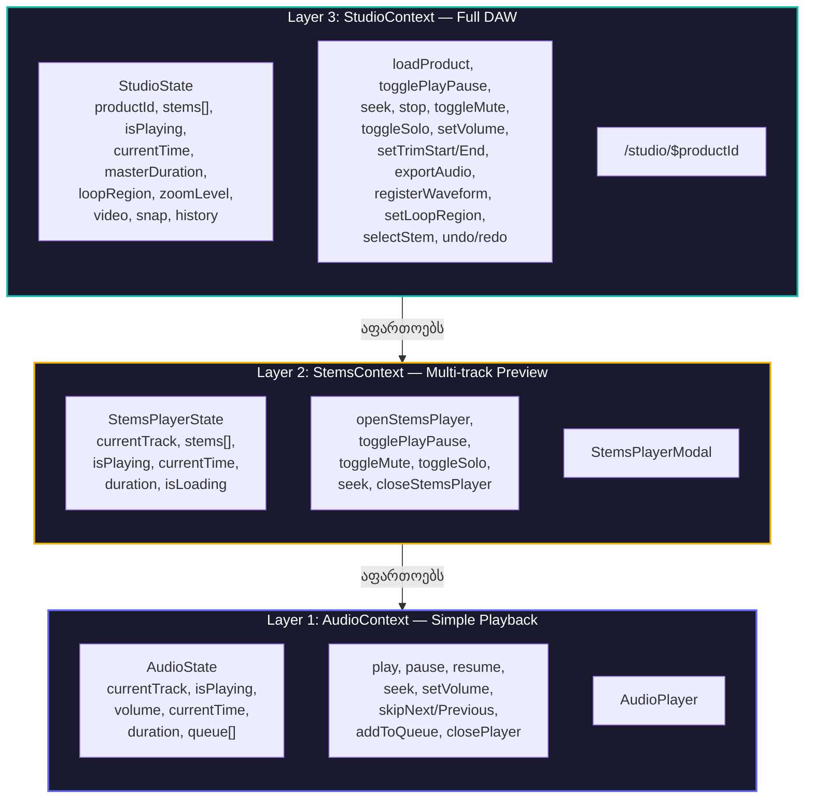

---

## 2. Stems Loading Pipeline

პროდუქტის ჩატვირთვის სრული ნაკადი: ავტორიზაციიდან მზადყოფნამდე.

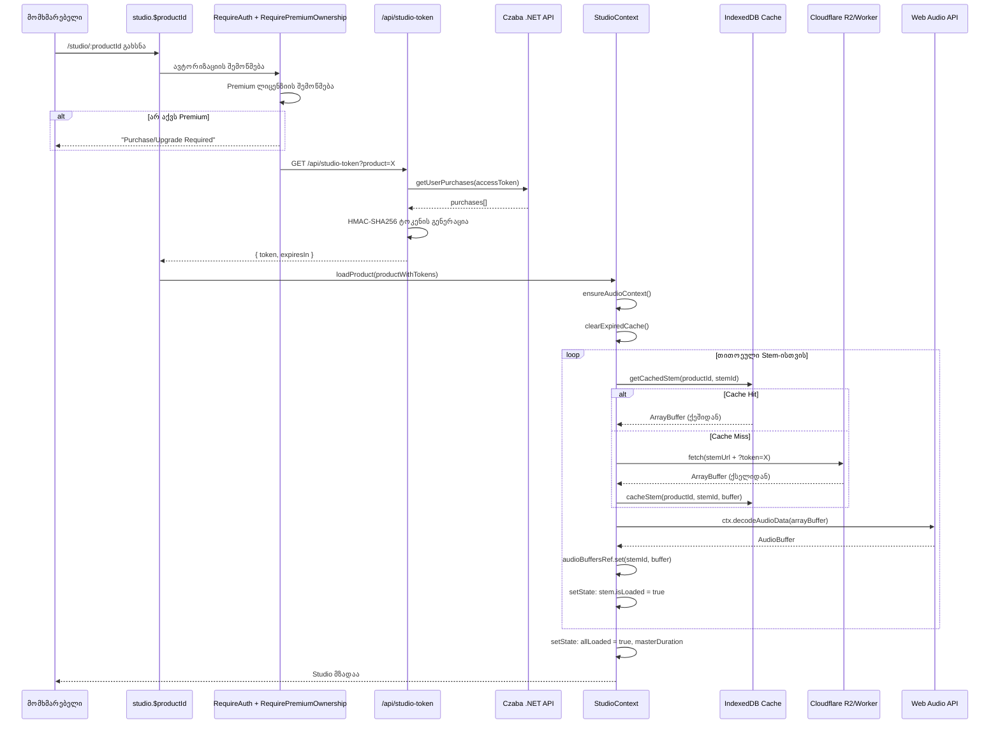

---

## 3. IndexedDB Caching Layer

360-დღიანი ქეშირების მექანიზმი ქსელის მოთხოვნების ოპტიმიზაციისთვის.

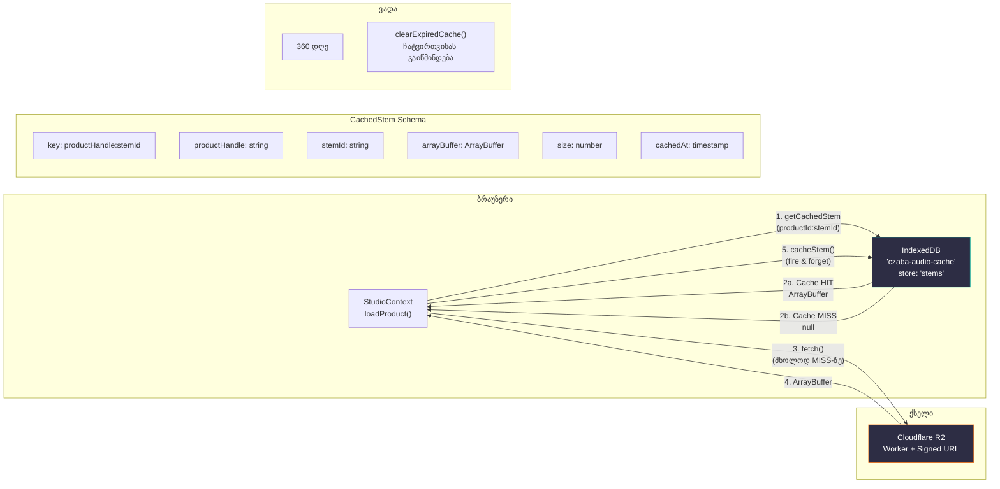

---

## 4. Web Audio API — Mixing Graph

რეალ-ტაიმ დაკვრის აუდიო გრაფი: Source → Gain → Destination.

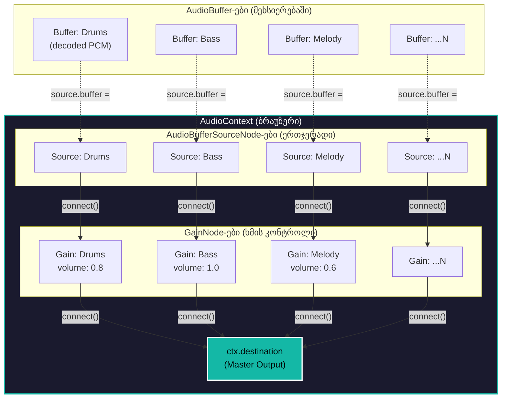

---

## 5. Solo/Mute ლოგიკა (Ableton-ის სტილი)

Ableton-ის სტანდარტი: Solo პრიორიტეტულია Mute-ზე.

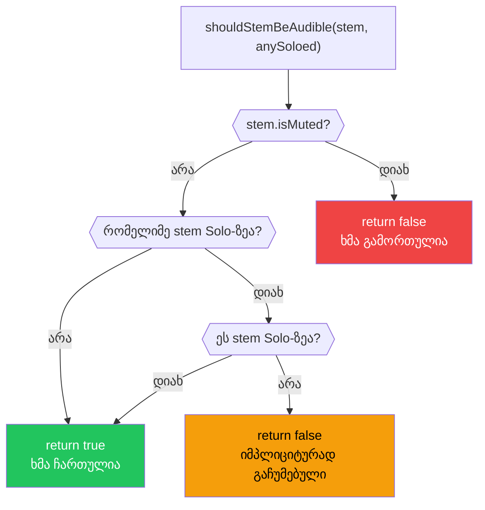

---

## 6. Playback State Machine

დაკვრის მდგომარეობათა ტრანზიციები.

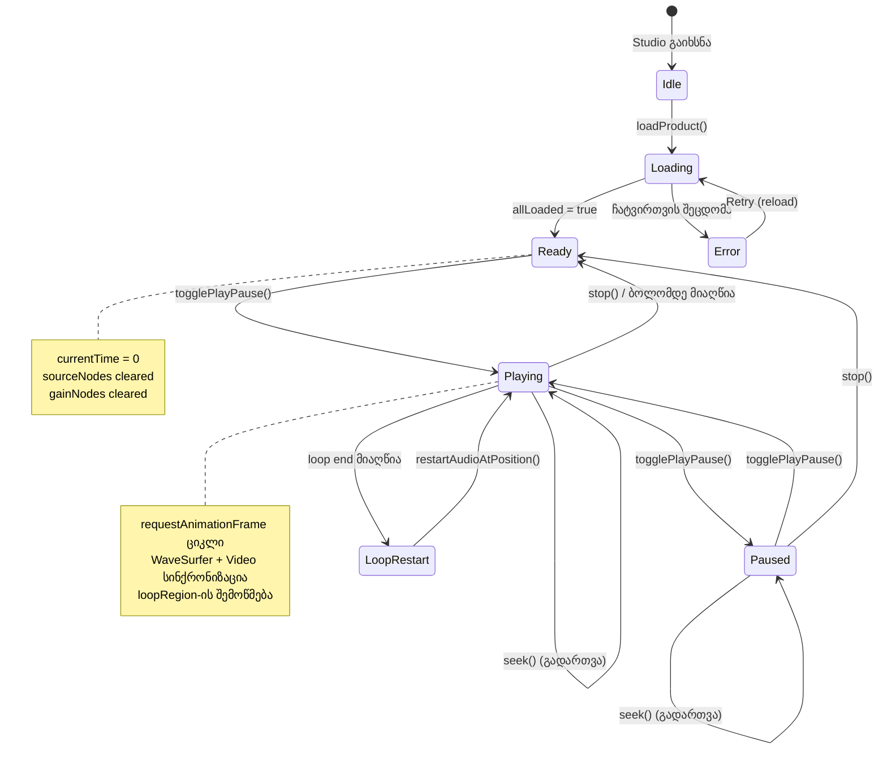

---

## 7. Export Pipeline

ექსპორტის სრული ნაკადი: OfflineAudioContext → WAV (Web Worker) → MP3 (FFmpeg.wasm).

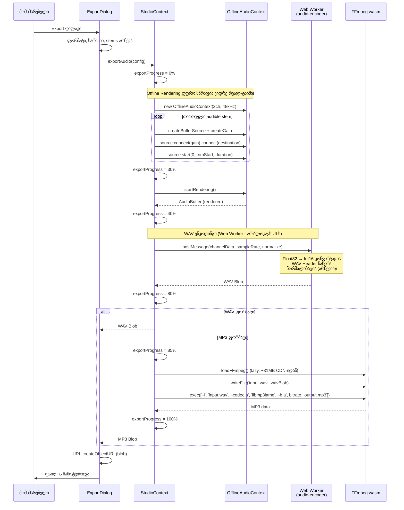

---

## 8. Ableton Live Set (.als) ექსპორტი

სტუდიის პროექტის Ableton Live-ში გადატანის ნაკადი.

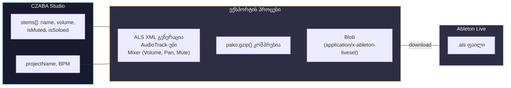

---

## 9. WaveSurfer ინტეგრაცია

Waveform ვიზუალიზაცია და სინქრონიზაცია StudioContext-თან.

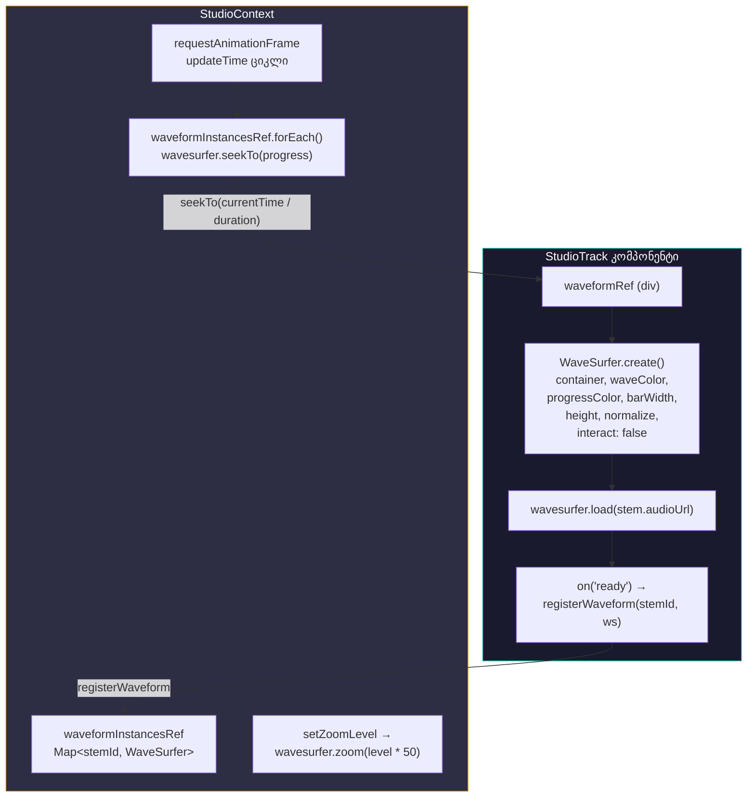

---

## 10. Error Handling Paths

შეცდომების დამუშავების ადგილები pipeline-ში.

```mermaid
flowchart TD
    subgraph Auth["ავტორიზაციის შეცდომები"]
        A1["RequireAuth: არ არის შესული"]
        A2["RequirePremiumOwnership: არ აქვს ნაყიდი"]
        A3["studio-token API: 401/403"]
    end

    subgraph Loading["ჩატვირთვის შეცდომები"]
        L1["AudioContext შექმნა ვერ მოხერხდა"]
        L2["Stem fetch() ვერ მოხერხდა<br/>(ქსელის შეცდომა)"]
        L3["decodeAudioData() ვერ მოხერხდა<br/>(დაზიანებული ფაილი)"]
        L4["IndexedDB შეცდომა<br/>(ქეში მიუწვდომელია)"]
    end

    subgraph Playback["დაკვრის შეცდომები"]
        P1["audio.play() rejected<br/>(autoplay policy)"]
        P2["AudioContext suspended<br/>(მომხმარებლის ინტერაქცია საჭიროა)"]
    end

    subgraph Export_Err["ექსპორტის შეცდომები"]
        E1["OfflineAudioContext შეცდომა"]
        E2["Web Worker შეცდომა"]
        E3["FFmpeg.wasm ჩატვირთვის შეცდომა<br/>(~31MB CDN-იდან)"]
        E4["FFmpeg კონვერტაციის შეცდომა"]
    end

    A1 -->|"redirect"| LoginPage["Login გვერდი"]
    A2 -->|"UI"| PurchasePage["Purchase/Upgrade UI"]
    A3 -->|"UI"| TokenError["Access Error + Retry ღილაკი"]

    L1 -->|"setState"| LoadFailed["isLoading: false, allLoaded: false"]
    L2 -->|"throw"| LoadFailed
    L3 -->|"throw"| LoadFailed
    L4 -->|"graceful"| FetchFromNetwork["ქსელიდან ჩატვირთვა<br/>(ქეში იგნორირდება)"]

    P1 -->|"catch"| PlayError["console.error + isPlaying: false"]
    P2 -->|"ensureAudioContext()"| Resume["ctx.resume()"]

    E1 -->|"throw"| ExportFailed["isExporting: false, exportProgress: 0"]
    E2 -->|"worker.onerror"| ExportFailed
    E3 -->|"throw"| ExportFailed
    E4 -->|"throw"| ExportFailed

    LoadFailed -->|"UI"| RetryUI["Retry ღილაკი"]
    ExportFailed -->|"alert"| ExportAlert["Export failed alert"]

    style Auth fill:#7f1d1d,stroke:#ef4444,color:#fff
    style Loading fill:#78350f,stroke:#f59e0b,color:#fff
    style Playback fill:#1e3a5f,stroke:#3b82f6,color:#fff
    style Export_Err fill:#4a1d5e,stroke:#a855f7,color:#fff
```

---

## 11. კომპონენტების იერარქია

Studio-ს UI კომპონენტების ხე.

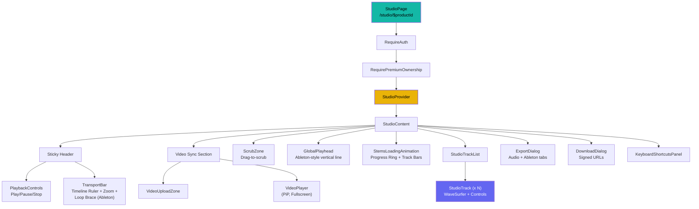

---

## 12. სრული Data Flow

მონაცემთა ნაკადი ბრაუზერიდან ექსპორტამდე.

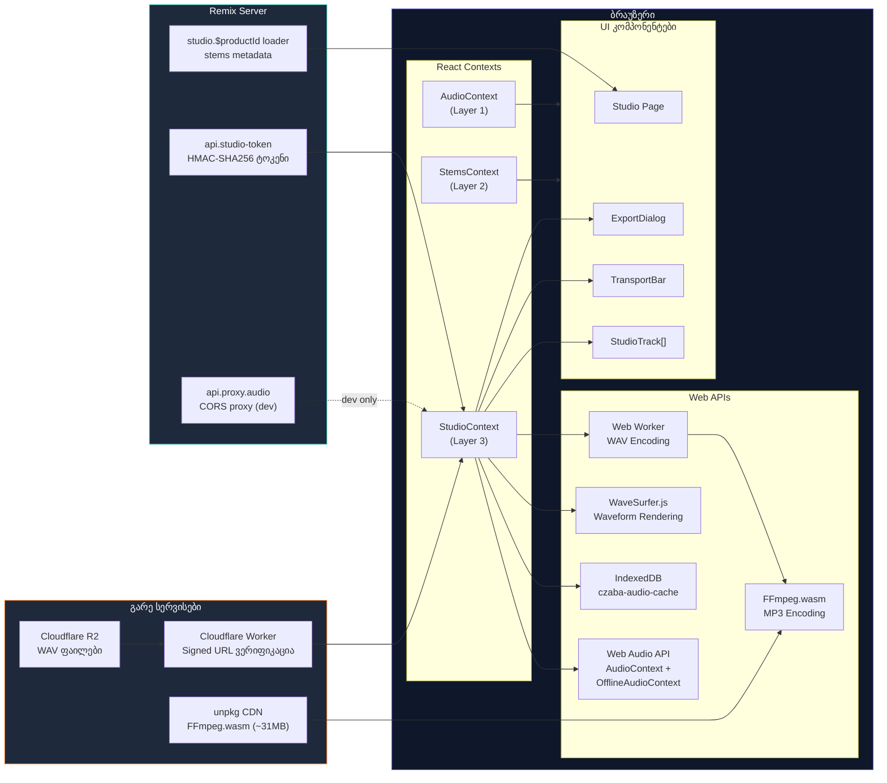
