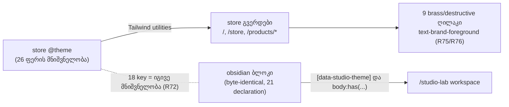

# Store — `@theme` ფერის ტოკენები Obsidian & Brass-ზე და მუქი ტექსტი brass/destructive ღილაკებზე (STORE-2a)

**თარიღი:** 2026-10-26
**სტატუსი:** Completed — Rounds 192–195 (STORE-2a). C PASS (round 195), გამოქვეყნებულია `7339cd5`-ში (gate 195).
**შეცვლილი პროექტი:** Store

## კონტექსტი

Saba-მ store-ის რედიზაინისთვის აირჩია მიმართულება A — Obsidian & Brass (პროექტის root-ის `docs/technical/store-redesign/direction-decision.md`, 2026-10-25). Spec-ის STORE-2 სტრიქონი ითხოვს store-ის `@theme`-ის გადაყვანას იმავე პალიტრაზე: სათაურები `#ECE6DA`, ძირითადი ტექსტი დაახლოებით `#CFC7BA`, caption-ები `#A39B8E`. Studio-ს obsidian ბლოკი byte-identical უნდა დარჩეს და store-ის markup-ს `data-studio-theme` არ ემატება.

STORE-2 ოთხ ეტაპად იყოფა: **2a** (ეს დოკუმენტი) — მხოლოდ `@theme`-ის ფერის მნიშვნელობები და ტექსტის ტოკენი ცხრა ღილაკზე; **2b** — hardcoded teal, glow blob-ები, gradient ტექსტი და `shadow-glow`; **2c** — ტიპოგრაფია და font loading; **2d** — motion და reduced motion, Lenis-ის ჩათვლით.

### რატომ არ შესრულდა 192-ე რაუნდში

192-ე რაუნდის დავალება ოთხ ღილაკს აძლევდა ნებართვას. A-ს K0.4 სკანირებამ იპოვა ხუთი დამატებითი, არადაცული ადგილი, სადაც ღია ფერის ტექსტი ან icon brass, buy ან destructive ფონზე დგას. დავალება ასეთ შემთხვევაში გაჩერებას ითხოვდა, ამიტომ A-მ კოდი არ შეცვალა. C-მ დამოუკიდებლად დაადასტურა, რომ სია სრული იყო და გაჩერება სწორი. ეს B-ს grant-ების დაგეგმვის ხარვეზი იყო და არა იმპლემენტაციის დეფექტი. 193-ე რაუნდში grant-ები ცხრა ადგილზე გაფართოვდა.

## მიდგომა

### გადაწყვეტილებები (Saba-ს შეუძლია ვეტო)

- **R72 — store-ის პალიტრა Studio-ს პალიტრას უდრის.** obsidian ბლოკის 18-ივე ფერის key store-ის `@theme`-ში ზუსტად იმავე მნიშვნელობას იღებს. ასე ისინი ერთმანეთს ვერ დაშორდება და `/studio-lab` უცვლელად რენდერდება.
  - უარყოფილი ალტერნატივა (a): store-ს override-ებულ key-ებზე Studio-სგან განსხვავებული მნიშვნელობები. ეს drift-ს ქმნის, ორ წყაროს ერთი ფერისთვის.
  - უარყოფილი ალტერნატივა (b): store-ის markup-ზე `data-studio-theme`. ამას კრძალავს TH4 და spec-ი.
- **R73 — ტექსტის ტონები spec-ს მიჰყვება.** სათაური `foreground` `#ece6da`, ძირითადი ტექსტი `secondary` `#cfc7ba`, caption `muted` `#a39b8e`. იცვლება მხოლოდ მნიშვნელობა; რომელი ელემენტი რომელ ტოკენს იყენებს, STORE-2c-ის საქმეა.
- **R74 — წარმოებული ტოკენები.** `bg-alt` და `surface-glass` თავისი წყვილის channel-wise შუა მნიშვნელობას იღებს (`.5` round-half-to-even-ით: `#1a1714`, `#12100f`). `surface-glass-strong` უდრის `surface`-ს. `*-rgb` triplet-ები brass-ს მიჰყვება. `buy` და `buy-hover` brass ხდება: buy-blue store-იდან გადის.
- **R75 — ღია ტექსტი brass-ზე ან ახალ destructive წითელზე აღარ რჩება.** ivory brass-ზე 1.88:1-ია (hover `#d9b87f`-ზე 1.52:1), ivory `#d2776a`-ზე — 2.57:1. ცხრავე არადაცული ადგილი `text-brand-foreground`-ზე (`#0e0d0c`) გადადის: brass-ზე 8.32:1, destructive-ზე 6.09:1.
  - უარყოფილი ალტერნატივა (c): ivory brass-ზე დატოვება (1.88:1, WCAG 1.4.3-ის დარღვევა).
- **R76 — keep-list-ის LeadMagnet CONTINUE ღილაკს მხოლოდ ტექსტის ფერი ეცვლება.** Saba-ს წესია „restyle them only; never remove or reword“. ტექსტის ფერის ტოკენი restyle-ია: copy, პოზიცია, ზომა და ქცევა უცვლელია.
  - უარყოფილი ალტერნატივა (d): CONTINUE-ის ivory-ზე დატოვება keep-list-ის შეუხებლობისთვის. ღილაკი 2.57:1-მდე ჩამოვარდებოდა, ანუ რეგრესია, რომელსაც ეს რაუნდი გამოიწვევდა.

### განზრახ უცვლელი

`info`, `error-*`, social, დეკორატიული (crystal/premium), video და `blue-*` alias ფერები; `glow-*`, ყველა `--shadow-*` და `--gradient-*` (STORE-2b); `--font-*` (STORE-2c); ანიმაციის ტოკენები (STORE-2d). შედეგად store-ში დროებით შერეული სახე რჩება: brass, და ზოგან teal gradient ან glow. ეს მოსალოდნელი შუალედური მდგომარეობაა.

## არქიტექტურა

Studio-ზე ეფექტი: obsidian ბლოკი 18 key-ს Studio-ს root-ზე და `body`-ზე override-ს უკეთებს, ამიტომ Studio ამ key-ებს store-ის მნიშვნელობიდან არ კითხულობს. დანარჩენი რვა key-ის (store-only) Studio-ში მოხმარება ქვემოთ ცხრილშია.

### K0 — Studio-ს მიერ override-ის გარეშე დარჩენილი ტოკენების მოხმარება

192-ე რაუნდის A-ს K0.1–K0.3 ცხრილი (ლუპის საქაღალდის `a-round-192.md`, რაუნდის ანგარიში), 193-ე რაუნდში ხელახლა გამოყენებული:

| ტოკენი | Studio-ში გამოყენება | obsidian override | ჩანს Studio-ს rest-ზე? |
|---|---|---|---|
| surface-glass | 0 | არა | — |
| surface-glass-strong | 0 | არა | — |
| secondary | `Toast.tsx:82` `text-secondary` | არა | **არა.** toast მხოლოდ CartContext-ის add/remove-ით იქმნება; `/studio-lab`-ს cart UI არ აქვს. |
| bg-alt | 0 | არა | — |
| brand-rgb | 0 (keyframe `glow-pulse` მხოლოდ store selector-ებში) | არა | — |
| accent-rgb | 0 | არა | — |
| buy / buy-hover | 0 | არა | — |
| obsidian-ის 18 key | ბევრი | კი | დიზაინით უცვლელია (R72) |

- `app.css`-ის class rule-ებში ამ var-ების 29 გამოყენებიდან არცერთი selector Studio-ს რენდერში არ გვხვდება.
- **ახალი ხაზი 193-ე რაუნდისთვის — `Modal.tsx`:** იცვლება მხოლოდ `ConfirmDialog`-ის destructive სტრიქონი. `ConfirmDialog`-ს მხოლოდ `routes/cart.tsx` იყენებს (default variant-ით). `ArrangementExportDialog` იმპორტს აკეთებს `Modal, ModalBody, ModalDescription, ModalHeader, ModalTitle`-ზე და არა `ConfirmDialog`-ზე (`ArrangementExportDialog.tsx:2`). ამიტომ export dialog-ის პიქსელები არ იცვლება; ეს ბრაუზერშიც გაიზომა (ქვემოთ, ტესტირება).

### ცხრა ადგილი (S1–S9)

| # | ფაილი | ელემენტი | ფონი | ivory ადრე (ძველ ფონზე) | ivory ახალ ფონზე | `text-brand-foreground` |
|---|---|---|---|---|---|---|
| S1 | `ui/Button.tsx` | `buy` variant | `bg-buy` | 4.05 | 1.88 | 8.32 |
| S2 | `ui/Button.tsx` | `destructive` variant | `bg-destructive` | 3.29 | 2.57 | 6.09 |
| S3 | `routes/hire-us.tsx` | submit | `bg-brand` | 1.55 | 1.88 | 8.32 |
| S4 | `routes/account.orders.tsx` | „Browse Music“ CTA | `bg-brand` | 1.55 | 1.88 | 8.32 |
| S5 | `product/PurchaseHeader.tsx` | Buy Now | `bg-buy` | 4.05 | 1.88 | 8.32 |
| S6 | `marketing/LeadMagnetPopup.tsx` | CONTINUE submit | `bg-destructive` | 3.29 | 2.57 | 6.09 |
| S7 | `ui/Modal.tsx` | ConfirmDialog destructive confirm | `bg-destructive` | 3.29 | 2.57 | 6.09 |
| S8 | `chat/ChatButton.tsx` | unread badge | `bg-destructive` | 3.29 | 2.57 | 6.09 |
| S9 | `auth/ForgetPassword.tsx` | `CheckCircle` icon `bg-brand` წრეში | `bg-brand` (მშობელი) | 1.55 | 1.88 | 8.32 |

- `ChatWidget`/`ChatButton` `caa09af`-ზე არცერთ route-ზე არ არის mount-ებული (`app/components/chat/`-ის გარეთ grep — 0 import). S8-ს მხოლოდ ST5 ფარავს.
- `Button`-ის `buy` და `destructive` variant-ს `caa09af`-ზე არცერთი route არ იყენებს; `ConfirmDialog`-ის destructive variant-საც (cart default variant-ს იყენებს). S1, S2 და S7 ბრაუზერში მიუწვდომელია და მათ ST5 ფარავს.
- დაცული `studio.$productId.tsx:440/471` და `account.downloads.tsx:261` იმავე pattern-ს შეიცავს და შეუხებელი რჩება (სიგნალი `STORE2A-PROTECTED-BRASS-TEXT`).

## შეცვლილი ფაილები

- `app/styles/app.css` — store-ის `@theme`-ში 26 `--color-*` მნიშვნელობა; ორ ხაზზე იმავე ხაზის კომენტარი ახალ ფერს ასახელებს (`#C9A46A`, `Brass`). obsidian ბლოკი, `:focus-visible` rule და დანარჩენი ფაილი უცვლელია.
- `app/components/ui/Button.tsx` — `buy` და `destructive` variant-ის ტექსტის ტოკენი.
- `app/routes/hire-us.tsx`, `app/routes/account.orders.tsx` — submit და CTA-ს ტექსტის ტოკენი.
- `app/components/product/PurchaseHeader.tsx` — Buy Now-ის ტექსტის ტოკენი.
- `app/components/marketing/LeadMagnetPopup.tsx` — CONTINUE-ის ტექსტის ტოკენი (copy უცვლელია).
- `app/components/ui/Modal.tsx` — `ConfirmDialog`-ის destructive სტრიქონი (ერთი ხაზი).
- `app/components/chat/ChatButton.tsx` — unread badge-ის ტექსტის ტოკენი.
- `app/components/auth/ForgetPassword.tsx` — `CheckCircle` icon-ის ფერის ტოკენი.
- `app/lib/__tests__/store-theme-tokens.test.ts` (ახალი, T1) — ST1–ST6. ST6 marker-ს ფაილების მიხედვითაც ამოწმებს (`StudioWorkspace.tsx`: 1, `app.css`: 2).
- `docs/implementation/2026/quarter-IV/157-saba-b-3-fader-pressed-state.md` — სტატუსი და `FS0–FS7`.

## პრობლემები და გადაწყვეტები

- **პრობლემა:** 192-ე რაუნდის grant-ები ოთხ ღილაკს ფარავდა, საჭირო კი ცხრა იყო. **გადაწყვეტა:** A გაჩერდა კოდის შეცვლამდე, B-მ 193-ე რაუნდში grant-ები ცხრა ადგილზე გააფართოვა. ხელახალმა K0 სკანირებამ S1–S9-ის გარეთ ახალი ადგილი არ იპოვა.
- **პრობლემა:** `Button.tsx`-ის `buy` variant ერთ ხაზზე იყო. `text-brand-foreground`-ით ხაზი 100 სიმბოლოს აღემატება და Biome formatter მას მრავალხაზოვან მასივად შლის. **გადაწყვეტა:** ფაილი Biome-ის formatter-ით დაფორმატდა, რადგან `npx biome check` 0 error-ს მოითხოვს. შინაარსობრივად იცვლება ერთი ტოკენი, მაგრამ diff-ში S1 ერთი ამოღებული და ექვსი დამატებული ხაზით ჩანს, იმავე სტილით, როგორც მეზობელი variant-ები. ეს SCOPE-ის „ერთი ხაზის“ მოთხოვნიდან გადახვევაა და B-ს ეცნობა.
- **პრობლემა:** start copy-ზე ახალი ტესტის (T1, `store-theme-tokens.test.ts`) red proof-ისთვის grant-ების დროებით გადაწერა dev server-ს ცვლის. **გადაწყვეტა:** T1 store root-ს `STORE_THEME_TOKENS_ROOT` გარემოს ცვლადიდან კითხულობს (default — რეალური repo). red proof და mutant-ები scratch ასლზე გაეშვა, repo-ს შეხების გარეშე.

## ტესტირება

- `npx vitest run app/lib/__tests__/store-theme-tokens.test.ts` — 6/6 მწვანე.
- Red proof start copy-ზე (`caa09af`-ის grant-ები, scratch ასლი): ST1, ST2, ST3, ST5 წითელია; ST4 და ST6 მწვანე.
- Mutant-ები (ერთი ცვლილება scratch ასლზე): m1 store `--color-brand` ძველ teal-ზე, m2 obsidian-ის `--color-muted`, m3 `--color-secondary` ძველზე, m4 `buy` variant, m5 hire-us submit, m6 `--color-buy` `#006AFF`-ზე, m7 Buy Now, m8 Modal destructive სტრიქონი, m9 `CONTINUE` → `Continue`. შედეგი: m1→ST1+ST3, m2→ST1+ST4, m3→ST2, m4/m5/m7/m8/m9→ST5, m6→ST2+ST3; დამატებით ChatButton, ForgetPassword, ConfirmDialog-ის ნეიტრალური სტრიქონი და orders CTA → ST5.
- მეზობელი suite-ები (37 ფაილი, მათ შორის `studio-theme-obsidian`, `panel-radius-ui`, `affordance-colour-ui`, `fader-style-ui`, export dialog-ის ყველა suite, `audio-preview-player`, `store-header-footer`) — 423/423 მწვანე.
- `npm run typecheck` — 0 error; `npm run lint` — 214 warning + 1 info (იგივე, რაც 191-ე რაუნდში); შეცვლილ ფაილებზე `npx biome check` — 0 error.
- ბრაუზერი (Playwright Chromium, :5173, mock :5199, DPR 2): 26-ვე ტოკენი სამ გვერდზე და სამ viewport-ზე ემთხვევა; `body` ფონი `rgb(14, 13, 12)`; Buy Now და hire-us submit — `rgb(14, 13, 12)` brass-ზე; CONTINUE — `rgb(14, 13, 12)` `#d2776a`-ზე. `/studio-lab` rest 1440/1280 და grid menu, marker menu, export dialog 1440-ზე — 0 შეცვლილი პიქსელი HEAD-თან. store-ის layout box-ები ±1 px-ში უცვლელია, keep-list-ის ტექსტი იდენტურია.

## TODO / შემდეგი ნაბიჯები

- [ ] C round 193: ბრაუზერის მიღება (TOKENS, CONTRAST, BRASS-TEXT, KEEP, LAYOUT, STUDIO-RV).
- [ ] დაცული `studio.$productId.tsx:440/471` და `account.downloads.tsx:261`-ის brass ტექსტი — auth სამუშაოს owner-ისთვის (`STORE2A-PROTECTED-BRASS-TEXT`).
- [ ] შეძენილი `/studio/:id` legacy view (`components/studio/**`) store-ის ტოკენებს კითხულობს — Tech Lead / backend-ით შემოწმება, cloud-ში მიუწვდომელია.
- [ ] STORE-2b: hardcoded teal, glow, gradient ტექსტი, `shadow-glow`; STORE-2c: ტიპოგრაფია; STORE-2d: motion.
- [ ] STORE-2b: `@theme`-ის მოძველებული კომენტარები (`#333640 - was 18%`, `#434750 - was 25%`, `was 35%`, WCAG შენიშვნა border-ებზე) — ამ რაუნდში მხოლოდ ორი, ახალ ფერზე პირდაპირ მიმთითებელი კომენტარი შეიცვალა.
- [ ] T1-ის byte guard-ები (`Button`-ის ოთხი უცვლელი variant, მათ შორის `hover:shadow-glow`) STORE-2b-ში განზრახ შესაცვლელი იქნება.

## Round 194 — LeadMagnet-ის placeholder და store-ის ველების border (fix-up)

### კონტექსტი

C-მ 193-ე რაუნდში CONTRAST-193-ზე ორი Medium რეგრესია იპოვა. ორივე 193-ე რაუნდის ტოკენების ცვლილებამ გამოიწვია:

- **C-R193-01:** keep-list LeadMagnet popup-ის მე-2 ნაბიჯზე email ველი `bg-white`-ია, placeholder კი `placeholder:text-dim`. `--color-dim` (`#928a7d`) მუქი ზედაპირის ტოკენია. თეთრზე ის **3.41:1**-ს იძლევა, HEAD-ზე კი **5.06:1** იყო (rendered pixels, 1440 და 375).
- **C-R193-02:** ტექსტის ველების border `border-outline`-ია (`#24211e`, R72-ის Studio-ს მნიშვნელობა) გვერდის `#0e0d0c` ფონზე. computed მნიშვნელობა **1.21:1**-ია (HEAD: 1.62). pixel-ებზე: newsletter **1.03** (HEAD 1.35), search **1.20** (1.61), hire-us **1.21** (1.62).

193-ე რაუნდის code-reviewer-მა `--color-outline` ≈1.25:1 info-დ მონიშნა, მაგრამ handover-მდე ველები არავის გაუზომავს. ეს RETRO-ს input-ია.

### გადაწყვეტილებები (Saba-ს შეუძლია ვეტო)

- **R77 (C-R193-01):** placeholder გახდა `placeholder:text-brand-foreground/60`. `#0e0d0c` 60 %-ით თეთრზე `rgb(110,110,109)`-ს იძლევა, რაც ≈5.1:1-ია.
  - უარყოფილია `placeholder:text-brand-foreground` სრული სიძლიერით (≈19:1). placeholder შეყვანილ მნიშვნელობას (`text-black`) დაემსგავსებოდა.
  - უარყოფილია `placeholder:text-outline-strong`. ის border-ის ტოკენია და მნიშვნელობით არასწორია.
  - უარყოფილია hardcoded ნაცრისფერი, რადგან Tailwind-first ამას კრძალავს.
  - ტექსტი `Enter your email address`, ზომა, პოზიცია და ქცევა უცვლელია.
- **R78 (C-R193-02):** store-ის ტექსტის ველები `border-outline`-დან `border-outline-strong`-ზე (`#736b60`) გადავიდა.
  - უარყოფილია `@theme`-ში `--color-outline`-ის შეცვლა. ის R72/ST1-ს არღვევს და ყველა card-სა და divider-ს ცვლის.
  - უარყოფილია ახალი `--color-input-border` ტოკენი. ის `app.css`-ს ცვლის და იმავე per-site ცვლილებებს მოითხოვს.
  - უარყოფილია ცვლილების გარეშე დატოვება, რადგან ამ რაუნდის რეგრესია ღია დარჩებოდა.
  - F1-ის fallback-ი (`border-dim`) **არ დასჭირდა**. newsletter-ის brass radial-ზე `border-outline-strong` ოთხივე midpoint-ზე ≥ 3.11:1 გაიზომა 1440-ზე, 1280-ზე და 375-ზე.
- **R79 (C-R193-03):** grant-ის „ერთი ხაზი“ ნიშნავს ერთ სემანტიკურ ტოკენის ცვლილებას. Biome-ის formatter-ის მიერ გამოწვეული reflow დასაშვებია, თუ ერთხაზოვან ფორმაზე `npx biome format` byte-for-byte იმავე ფაილს იძლევა. ამ რაუნდში reflow არ მომხდარა.

### შეცვლილი ადგილები

- **P1:** `marketing/LeadMagnetPopup.tsx` — email ველის placeholder.
- **F1:** `home/NewsletterSection.tsx`, newsletter email.
- **F2:** `routes/store.tsx`, ძიება.
- **F3–F6:** `routes/hire-us.tsx`, name, email, budget `<select>` და message `<textarea>`.
- **F7:** `routes/free-downloads.tsx`, email (keep-list გვერდი, მხოლოდ restyle).
- **F8:** `routes/gift-cards.tsx`, კოდი.
- **F9:** `cart/GiftCardInput.tsx`.
- **F10:** `routes/cart.tsx`, კუპონის/gift card-ის ველი.
- **F11–F13:** `routes/account.tsx`, პაროლის სამი ველი.
- **F14:** `ui/Input.tsx`, `baseInputStyles`.
- **F15:** `ui/Input.tsx`, `Textarea`.
- **F16:** `chat/ChatInput.tsx`. ChatWidget არცერთ route-ზე არ არის mounted. თუმცა `ChatWindow.tsx:75` `ChatInput`-ს არენდერებს, `ChatWindow` კი `/support`-ზეა (`support.tsx:69`). ამიტომ F16 ჩატის სესიის არსებობისას ხილვადია (mock-ზეა დამოკიდებული) და C-მ მისი გაზომვა უნდა სცადოს.
- ტესტი `store-theme-tokens.test.ts`: **ST7**, **ST8** (F1–F16, ელემენტი stable anchor-ით მოიძებნება) და **ST8b**. ST8b class guard-ია: `app/`-ის ყველა `<input|textarea|select>`-ის 14-ხაზიან ფანჯარაში bare `border-outline` არ უნდა იყოს (`__tests__`, `components/arrangement`, `components/studio` გარდა).

ორი legacy ველი, `components/studio/ExportDialog.tsx:283` (checkbox) და `components/studio/VideoUploadZone.tsx:169`, აკრძალულ ფაილებშია და არ შეცვლილა (`STORE2A-INPUT-BORDER-STUDIO-SITES`). Studio (`components/arrangement`) `~/components/ui`-დან მხოლოდ `Modal*`-ს იყენებს (`ArrangementExportDialog.tsx:2`), ამიტომ `Input`/`Textarea`/`ChatInput` მას არ ეხება.

### K0-ის stop rule (code review-ის შემდეგ)

**პრობლემა:** K0-ის სკანირებამ (`fieldscan.mjs`-ის ანალოგი) F1–F16-ის გარეთ ველები ვერ იპოვა. ამიტომ ამ რაუნდის ცვლილებები შესრულდა. code-reviewer-მა შემდეგ იპოვა ველები აუკრძალავ ფაილებში, რომლებიც ისევ bare `border-outline`-ს იყენებენ:

- `chat/GuestForm.tsx:67` (name) და `:91` (email), `bg-elevated` ფონზე. ფორმა `/support`-ზეა (`support.tsx:69` → `ChatWindow.tsx:57`) და ანონიმური ვიზიტორისთვის ხილვადია.
- `recordings/SfxSoundLibrary.tsx:68` (→ `:97` search, `:109` select), `SfxSceneBuilder.tsx:112` (→ number input-ები, `:783` select), `SfxVideoSync.tsx:25`, `SfxQuickEdit.tsx:183`. ყველა `bg-background` ფონზეა. route-ებია `/scenes/:id` და `/recordings/:id`, რომლებიც backend-ზეა დამოკიდებული.

**რატომ გამოტოვა სკანირებამ:** ფანჯარა `i+14` exclusive-ია, ანუ tag და შემდეგი 13 ხაზი. GuestForm-ის ტოკენი tag-იდან +14-ე ხაზზეა. class constant-ის (`inputClass = ...`) სახელი class-ის სტრიქონის წინა ხაზზეა, ამიტომ ხაზის შიგთავსით ფილტრირებულმა grep-მა ის ვერ დაიჭირა.

**გადაწყვეტა:** ეს ფაილები grant-ში არ არის. ამიტომ ისინი არ შეცვლილა და B-ს re-grant-ს ელოდება. B-ს შეუძლია `recordings/` Studio-სთან მიმდებარედ გამოაცხადოს. ST8b ისე დარჩა, როგორც B-მ განსაზღვრა (14 ხაზი, constant-ებს არ მიჰყვება). მისი გაძლიერება მიმდინარე tree-ზე წითელს მოიტანდა. შემოთავაზებული ფორმა: className-ის balanced parser, იმავე ფაილის constant-ებზე მიყოლა და deny-list (`border-outline`, `-light`, `-hover`, side variant-ები).

### ტესტირება (Round 194)

- `store-theme-tokens.test.ts`: 24/24 მწვანე.
- Red proof start copy-ებზე: ST7, ST8 ×16 და ST8b წითელია, ST1–ST6 მწვანე.
- Mutant-ები: m10→ST7, m11→ST8 F2 (+ST8b), m12→ST8 F14, m13→ST8b.
- მეზობელი suite-ები (`gift-card-input`, `store-header-footer`, `studio-theme-obsidian`): 48/48 მწვანე.
- `npm run typecheck`: 0 error. `npm run lint`: 214 warning + 1 info. შეცვლილ ფაილებზე `npx biome check`: 0 error.
- ბრაუზერი (Playwright Chromium, :5173, mock :5199, DPR 2). ოთხივე edge midpoint-ზე:
  - F1: 3.11–3.47 (1440, 1280, 375);
  - F2: 3.64–3.67;
  - F3–F6: 3.70;
  - F7: 3.50–3.53;
  - F8: 3.30;
  - F14 sign-in modal: 3.50.
- keyboard focus-ზე border brass ფერზე გადადის.
- LeadMagnet-ის placeholder: 5.1:1, შეყვანილი მნიშვნელობა 21:1.
- `/studio-lab` rest 1440: 0 შეცვლილი პიქსელი.
- F9/F10 ცარიელ კალათაში არ ჩანს. F11–F13 ავტორიზაციას მოითხოვს (backend cloud-ში მიუწვდომელია).

### TODO

- [ ] C round 194: PLACEHOLDER, FIELD-BORDER, CONTRAST, KEEP, STORE-LAYOUT, STUDIO-RV.
- [ ] STORE-2b: ველების გარდა `border-outline`-ის ზედაპირების ინვენტარი (pill-ები, card-ები, divider-ები, chip-ები) და მათი კონტრასტი.
- [ ] B re-grant: GuestForm-ის ორი ველი და `recordings/`-ის ოთხი class constant, ასევე ST8b-ის გაძლიერება (15 ხაზი, constant-ები, deny-list).
- [ ] STORE-2b: `FilterBar.tsx:99`, `.sort-select` (`app.css:2219`, `var(--color-outline)`). class scan მას ვერ ხედავს, `app.css` კი frozen-ია.

## Round 195 — `/support`-ის guest ფორმა, `recordings/`-ის ველები და whole-tag ST8b (fix-up 2)

### კონტექსტი

C-ის 194-ე რაუნდი FAIL იყო (`browserVerified=true`). 13-ვე granted ადგილი ბრაუზერში გავიდა, მაგრამ grant-ის გარეთ ორი Medium აღმოჩნდა:

- **C-R194-01:** `/support` → "Live Chat" ფორმის ორი ველის (`#guest-name`, `#guest-email`) border-ის კონტრასტი **1.21:1** იყო. HEAD-ზე (`caa09af`) ის 1.62:1 იყო, ანუ ეს 193-ე რაუნდის `--color-outline` ცვლილების რეგრესიაა.
- **C-R194-02:** ST8b-ის 14-ხაზიანი ფანჯარა ამ layout-ზე ცრუ PASS-ს იძლეოდა: GuestForm-ის ტოკენი tag-იდან +14-ე ხაზზეა, `inputClass` constant-ებს კი სკანერი არ მიჰყვებოდა.

ეს სექცია ზემოთ მოცემულ "K0-ის stop rule"-ს და round-194-ის TODO-ში ჩაწერილ re-grant-ს ხურავს. ST8b-ის 14-ხაზიანი აღწერა მხოლოდ round 194-ის ისტორიაა.

### გადაწყვეტილებები (Saba-ს შეუძლია ვეტო)

- **R78 GuestForm-ზეც ვრცელდება.** ორი ველის non-error branch: `border-outline` → `border-outline-strong`. error branch (`border-destructive focus:border-destructive`), focus ring, placeholder, ტექსტი და ქცევა უცვლელია.
- **R81 (fallback):** თუ `border-outline-strong` რომელიმე viewport-ზე ოთხი midpoint-დან ერთზე მაინც 3:1-ზე დაბალი იქნებოდა, ორივე ველი `border-dim`-ზე გადავიდოდა. **საჭირო არ გახდა:** გაზომილი 3.70:1-ია (იხ. ქვემოთ). გამოყენებულია `border-outline-strong`.
- **R80:** `app/components/recordings/**` store-ის scope-ია. ის `global_forbidden_files`-ში არ არის (იქ `app/lib/sfx-*`-ია), store-redesign-ის Studio-ს სიაშიც არ არის, Studio მას არ იმპორტებს და მხოლოდ `/recordings/:productId`-სა და `/scenes/:productId`-ზე mount-დება. ოთხი `inputClass` constant იგივე swap-ს იღებს.
  - უარყოფილი (a): folder-ის ST8b-დან გამორიცხვა. ეს loop-ის მიერ გამოწვეულ რეგრესიას დამალავდა.
  - უარყოფილი (b): შემდეგ რაუნდზე გადადება. guard ან წითელი დარჩებოდა, ან whitelist დასჭირდებოდა.
- **R82:** ST8b ხაზების ფანჯრის ნაცვლად მთლიან tag-ს კითხულობს. `app/`-ის ყოველ `.tsx`-ში (`__tests__`, `components/arrangement`, `components/studio` გარდა) `<input`, `<textarea`, `<select` tag აიღება `<`-დან brace depth 0-ზე დახურვის `>`-მდე. ბრჭყალები და template literal-ები გამოტოვებულია, `=>` tag-ს არ ამთავრებს. tag ჩავარდება, თუ მასში bare `border-outline` (`/border-outline(?![-\w])/`) წერია, ან თუ ის იმავე ფაილის `const NAME =`-ს მიმართავს, რომლის initialiser (string, template literal, array ან `cn(...)`, `;`-მდე) bare `border-outline`-ს შეიცავს.
  - `-light`/`-hover`/side variant-ები deny-list-ში **არ** დაემატა. ისინი არავის გაუზომავს და signal-ად რჩება.

### შეცვლილი ადგილები

| # | ფაილი | ცვლილება |
|---|---|---|
| G1 | `chat/GuestForm.tsx` (`#guest-name`) | non-error branch → `border-outline-strong` |
| G2 | `chat/GuestForm.tsx` (`#guest-email`) | იგივე, იგივე ტოკენით |
| R1 | `recordings/SfxSoundLibrary.tsx` `inputClass` | `border-outline` → `border-outline-strong` |
| R2 | `recordings/SfxSceneBuilder.tsx` `inputClass` | იგივე |
| R3 | `recordings/SfxVideoSync.tsx` `inputClass` | იგივე |
| R4 | `recordings/SfxQuickEdit.tsx` `inputClass` | იგივე |

`inputClass`-ის 12 მომხმარებელი (2 + 6 + 2 + 2) ყველა `<input>` ან `<select>`-ია. იმავე ფაილების section-ები, fieldset-ები და card-ები (`border border-outline`) უცვლელია და STORE-2b-ის ინვენტარს ეკუთვნის. Biome reflow არ მომხდარა.

### ტესტი (`store-theme-tokens.test.ts`)

- **ST8:** დაემატა G1/G2 (`id="guest-name"`, `id="guest-email"` anchor-ით; მიიღება `border-outline-strong` ან R81-ის `border-dim`) და R1–R4 (`const inputClass =` anchor-ით, მიიღება `border-outline-strong`). constant-ის region ახლა `;`-მდე იჭრება bracket და ბრჭყალების აღრიცხვით, `\n]`-ზე აღარ არის დამოკიდებული. tag-ის anchor და `className` tag-ის შიგნით უნდა იყოს. region delimiter-ებს აღარ შეიცავს (reviewer Low #4–#6).
- **ST8b:** `bareOutlineFieldHitsInSource(path, source)` pure ფუნქციაა. walker დამატებით ამოწმებს, რომ სკანირებულ ფაილებში `GuestForm`, `SfxSceneBuilder`, `hire-us` და `store` route-ია, excluded folder-ები არ მოხვდა და field tag-ების რაოდენობა ≥ 50-ია (დღეს 60). ასე ST8b ცარიელ სკანირებაზე ვერ გაივლის.
- **ST8c:** in-memory self-test. ფლაგავს: (i) `className` `<input`-იდან 14+ ხაზით ქვემოთ, (ii) string constant `className={inputClass}`-ით, (iii) იგივე `` `${inputClass} mt-3` ``-ში, (iv) `onChange={(e) => …}` bare `className`-მდე, (vii) `<textarea disabled={length > 3}>`, (viii) `cn(...)` constant `<select>`-ზე. არ ფლაგავს: (v) `border-outline-strong`, (vi) ველის გარეშე `<section className="border border-outline">`.

### ტესტირება (Round 195)

- `store-theme-tokens.test.ts`: 38/38 მწვანე.
- **Red proof** round-194 tree-ის ასლზე (`STORE_THEME_TOKENS_ROOT`, 5 წყარო ფაილი start copy-ით): ST8 G1, G2, R1–R4 და ST8b წითელია (7). ST1–ST7, ST8 F1–F16 და ST8c მწვანეა (31). ST8b ზუსტად 14 hit-ს აბრუნებს, B-ის `fieldscan2.mjs`-ის იდენტურს.
- Mutant-ები (scratch ასლზე): m15 (`const fieldClass` → `<input>` `store.tsx`-ში) → ST8b წითელი; m18 (ველის გარეშე `<section>`) → მწვანე.
- მეზობელი suite-ები (`sfx-library`, `sfx-scene-route`, `sfx-video-transport`, `studio-theme-obsidian`): მწვანე, T1-თან ერთად 58/58.
- `npm run typecheck`: 0 error. `npm run lint`: 214 warning + 1 info (194-ის ტოლი). 6 კოდის ფაილზე `npx biome check`: 0.
- ბრაუზერი (Playwright Chromium, :5173, mock :5199, DPR 2, `--disable-lcd-text`). `#guest-name` და `#guest-email` ოთხივე midpoint-ზე, ველის გარეთ 2 CSS px-ის პიქსელთან: **3.70:1** 1440×900, 1280×720 და 375×812-ზე (border `rgb(115, 107, 96)`). keyboard focus-ზე border brass-ია (`rgb(201, 164, 106)`). ცარიელი submit-ზე ორივე ველი `border-destructive`-ს აჩვენებს.
- F2 (`/store` search) 1440: 3.64 (უცვლელი).
- `/studio-lab` rest 1440 vs `c-round-191`: 0 შეცვლილი პიქსელი, 0 console error.
- `/recordings/:id` და `/scenes/:id`: **BLOCKED** — backend cloud-ში მიუწვდომელია (mock sign-in-ს ითხოვს). R1–R4-ს მხოლოდ ST8 ფარავს.

### RETRO შენიშვნა

193-ე რაუნდის B-ის სკანირებამ GuestForm (ფანჯრის off-by-one) და class constant-ები გამოტოვა. ამიტომ K0-ის სკანირება ახლა B-ის whole-tag ინსტრუმენტია (`fieldscan2.mjs`), ST8b კი იმავე წესით მუშაობს.

### TODO

- [ ] C round 195: GUEST-BORDER, FIELD-SPOT, CONTRAST, KEEP, STORE-LAYOUT, STUDIO-RV, T-RUN, SCOPE.
- [ ] Backend-ის მქონე გარემოში: `/recordings/:id` და `/scenes/:id` ველების კონტრასტი.
- [ ] STORE-2b: ველების გარდა `border-outline`-ის ზედაპირები და `-light`/`-hover`/side variant-ების გაზომვა.
