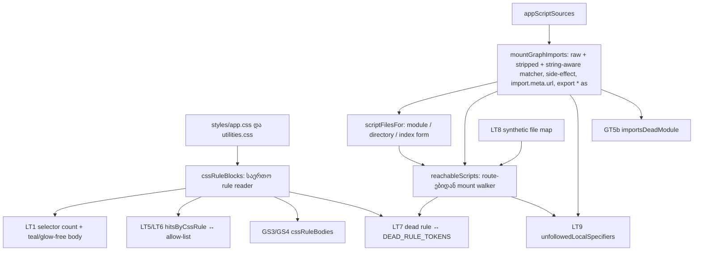

# STORE-2b-3c-2a: ერთი საერთო CSS rule reader და „dead“ teal წესების mounted consumer-ის შემოწმება

**თარიღი:** 2026-11-11
**სტატუსი:** In Progress (stage 1 of 2; C round 458 PASS)
**შეცვლილი პროექტი:** Store (მხოლოდ ტესტები: `app/lib/__tests__/helpers/style-scan.ts`, `store-live-teal.test.ts`, `store-glow-shadow.test.ts`, `store-gradient-text.test.ts`)

## კონტექსტი

- `store-live-teal.test.ts`-ის allow-list teal-ს უშვებს CSS წესებში, რომლებსაც reason-ში „dead“ აწერია, მაგრამ არაფერი ამტკიცებდა, რომ ამ კლასებს mounted consumer არ ჰყავს. ოთხი dead token (`audio-preview-inline-button`, `waveform-bar`, `track-row-waveform`, `loading-brand`) კომპონენტების წყაროში დღესაც გვხვდება. ეს იყო ღია Medium A-R454-REVIEW-M-DEAD-UNCHECKED.
- CSS წესების წასაკითხად სამი ცალკე პარსერი იყო: line-regex reader `store-live-teal.test.ts`-ში, მეორე (`ruleBodiesFor`) `store-glow-shadow.test.ts`-ში და brace-aware walker `helpers/style-scan.ts`-ში მხოლოდ gradient text-ისთვის. სიგნალები SIG-R453-CSSRULEBODIES და SIG-R454-HITSBYRULE ერთ nesting-aware reader-ს ითხოვდნენ.
- იმავე ცვლილებას ეკუთვნის Low-ები: TL-R454-L-BRACE-PREFIX-HEADER (`} .live:hover {` ხაზი attribution-ს ასცდებოდა), A-R454-REVIEW-L3 (LT1 მხოლოდ top-level ზუსტ ხაზებს ხედავდა), A-R454-REVIEW-L4 (`@theme` bucket არასდროს იხურებოდა), A-R453-REVIEW-L-GS-TEST-GAPS (GS2 ვერ იჭერდა `shadow-glow-accent`-ს, GS3-ის reader nested/quoted braces-ს ტოვებდა, GS3 `.button-primary`-ის fill-ს არ ამოწმებდა).
- Round 456-ის review-მ (A-R456-REVIEW-M1, Medium) აჩვენა, რომ mount walker-ი `import`/`export … from` ჩანაწერს ტოვებდა, თუ მის braces-ში კომენტარი იდგა. ამიტომ `components/animations/ScrollReveal.tsx` unmounted ჩანდა, თუმცა `routes/_index.tsx` მას კომენტარიანი barrel-ით (`components/animations/index.ts`) იღებს. B-ის sweep-მა იმავე კლასის კიდევ ორი ფორმა იპოვა: worker-ები `new URL('./x.worker.ts', import.meta.url)`-ით და side-effect `import '…'` / `export * as N from`. ეს LT7-ის „unmounted“ ვერდიქტისთვის სახიფათო მიმართულებაა (fail open), ამიტომ ეტაპი round 457-ში ხელახლა გაიცა.
- STORE-2b-3c-2 ორ ეტაპადაა: **2b-3c-2a (ეს ეტაპი)** — საერთო reader და dead consumer-ის მტკიცება; **2b-3c-2b (შემდეგი)** — zero-offset glow regex-ის ფორმები.

## მიდგომა

- **ერთი reader.** `helpers/style-scan.ts` იღებს brace-aware CSS block reader-ს: კომენტარებსა და quoted delimiter-ებს ჯერ ბლანკავს, შემდეგ ყოველ წესს აბრუნებს normalized header-ით, body-თი და nesting-ის კონტექსტით (`@media`, `@supports`, `@layer`, `@container`, `@scope` grouping at-rule-ები key-ში შედის). მასზე დგას selector-ის დათვლა, body-ების წაკითხვა და teal hit-ების rule-ზე მიბმა. ძველი line-regex reader-ები ორივე ტესტ ფაილიდან წაიშალა.
- **Allow-list-ის key-ები ფორმას იცვლის, რაოდენობა — არა.** ყოველ key-ს ბოლო ` {` მოეხსნა, რადგან reader normalized header-ს აბრუნებს; count-ები და reason-ები უცვლელია.
- **Mount walker.** `reachableScripts` იწყებს `root.tsx`-დან, `entry.client.tsx`-დან, `entry.server.tsx`-დან და `routes/**`-დან და კავშირებს `mountGraphImports`-დან იღებს. ეს წყაროების გაერთიანებაა (union):
  - import matcher-ი სამ arm-ზე: ორიგინალ წყაროზე, კომენტარებგაწმენდილ წყაროზე (`withoutComments`) და string-aware arm-ზე (`withoutCommentsOutsideStrings`), რომელიც კომენტარებს შლის, string literal-ებს კი ინარჩუნებს (`import`/`export … from` და `import('…')`, `~/` ან relative specifier). ამიტომ `'audio/*'` სტრიქონი ყალბ კომენტარს აღარ ხსნის;
  - მხოლოდ string-aware arm-ზე clause, რომელიც მკაცრ `IMPORT_CLAUSE_GRAMMAR`-ს ვერ აკმაყოფილებს (მაგ. clause-ში შეჭმული `interface P {}`), მთელი მოდულის კავშირად ითვლება (`wholeOnUnparsedClause`). ყველა arm-ზე ეს fallback ზედმეტს აღწევდა (`// Barrel export for …` კომენტარი ფსევდო statement-ს იწყებდა), ამიტომ ერთ arm-ზეა შეზღუდული;
  - side-effect `import '…'` და worker-ის `new URL('…', import.meta.url)`, ორივე მთელი მოდულის კავშირად;
  - `export * as N from` ერთ სახელად: როცა `N` მოითხოვება, მთელი target-ი გაივლება.

  თითო arm ფარავს hazard-ს, რომელიც დანარჩენებს აბრმავებს: მაგალითად, comment-stripped arm-ი მიჰყვება import-ს, რომელსაც string-aware arm-ი შეჭამს და raw arm-ი ვერ პარსავს (LT9-ის regex literal-ის row). ცნობილი შემთხვევები, როცა ორივე comment-stripping arm-ი ბრმავდება (`/*` regex literal-ში — TL-R458-L1; nested template `/*`-ით — მისი გაფართოება), TODO-შია ჩამოთვლილი; ყველა arm-ი import-ს მხოლოდ მაშინ აცდება, როცა მის clause-ში (მაგ. braces-ში) კომენტარიცაა და raw arm-ი მას ვერ პარსავს. import matcher-ის სამივე arm-ს ცალკე mutant-ი აპინებს: comment-stripped arm-ს M21a, raw arm-ს M22a, string-aware arm-ს M35. `export * as N`-ის string-aware ჩანაწერს ცალკე mutant-ი არ აპინებს (raw arm-ის namespace კავშირი იმავე target-ს ფარავს).
- **Specifier-ის სამი ფორმა.** `resolveSpecifier` აშორებს `?query`-ს, `#hash`-ს, extension-ს და `/index`-ს და აბრუნებს `{ target, form }`-ს (`SpecifierForm`). ეს მოშორება დამთხვევებს არა მხოლოდ ამატებს: ის `u/`-სა და `u`-ს ერთ target-ად აერთიანებდა. ორი რეალური resolver-ი აქ ერთმანეთს არ ემთხვევა — Vite/vitest relative `'./u/'`-ს `u.ts` ფაილზე, alias `'~/…/u/'`-ს კი `u/index.ts`-ზე ხსნის (`b-round-457/probe/vite-resolution.txt`), TypeScript (`--moduleResolution bundler`) `'./u/'`-ს `u/index.ts`-ზე ხსნის (A, round 457). ამიტომ `scriptFilesFor` ყოველ ფორმას ისე ხსნის, რომ ორივე resolver-ის შესაძლო ფაილი გაიაროს:
  - `'module'` (ჩვეულებრივი `'~/lib/u'`) — ჯერ ფაილი, შემდეგ index (ორივე resolver-ი თანხმდება);
  - `'directory'` (ბოლო `/`, `'~/lib/u/'`) — ფაილიც და index-იც, თუ არსებობს (over-reach fail closed-ია);
  - `'index'` (ცხადი `/index` ან `/index.tsx`) — მხოლოდ index (ორივე resolver-ი თანხმდება).

  `unfollowedLocalSpecifiers` (LT9) `form|target` წყვილებს ადარებს და ამოწმებს, რომ ფორმა script ფაილზე იხსნება. `'./a/index'` მარტო `a.tsx`-ის გვერდით unfollowed-ად ჩანს, რადგან `index` ფორმა `a/index.*`-ს ვერ პოულობს (`scriptFilesFor` ცარიელ სიას აბრუნებს).
- **LT7-ის consumer lookahead.** `tokenPattern`-ის lookahead `(?![\w-])`-დან `(?![A-Za-z0-9-])`-ზე გადავიდა, ამიტომ `animate-[playButtonPulse_1s_infinite]` და `[&_.value-card_span]` consumer-ად ითვლება (fail closed; LT10).
- **Barrel-ის წესი უცვლელია.** ფაილი barrel-ად ითვლება მხოლოდ მაშინ, როცა ყოველი statement `export … from`-ია; barrel-იდან named import მხოლოდ იმ სახელების re-export-ში შედის, `export *` სახელებს გადასცემს. ალტერნატივა — მთელი barrel-ის გავლა — უარყოფილია: ასეთი წესით ოთხივე unmounted ფაილი reachable ჩანდა და შემოწმება უაზრო იქნებოდა. `export * as N`-ის raw namespace ჩანაწერიც რჩება; ეს over-reach fail closed-ია: მეზობელი barrel ფაილი reachable ხდება, მისი leaf — არა (LT8).
- **მუდმივი დაცვა — LT9.** app source-ის ყოველი `'~/…'`, `'./…'` ან `'../…'` literal-ს walker-ი უნდა მიჰყვეს და ის script ფაილზე ან ცნობილ asset extension-ზე უნდა resolve-დებოდეს (`unfollowedLocalSpecifiers`). გამონაკლისი მხოლოდ დასაბუთებული `UNFOLLOWED_SPECIFIER_ALLOW_LIST`-ით შეიძლება (დღეს ცარიელია, stale ჩანაწერის შემოწმებით). ასე import-ის შემდეგი უცნაური სინტაქსი LT9-ს გააწითლებს და „unmounted“ ვერდიქტად არ გაიპარება.
- **GT5b იმავე კავშირებზე.** `store-gradient-text.test.ts`-ის `importsDeadModule` ახლა `mountGraphImports`-ს კითხულობს. `.some` უფრო დიდ სიმრავლეზე GT5b-ს მხოლოდ უფრო მკაცრს ხდის; დაემატა სამი positive row: `export * as Aud from '~/components/audio'`, კომენტარიანი braces-ის import და side-effect import.
- **AudioPreviewButton** reachable-ია, ამიტომ მისთვის ცალკე წესი მოქმედებს: component-ის default `variant = 'overlay'`-ია, overlay branch-ში მხოლოდ overlay კლასია, inline კლასი ამ branch-ის შემდეგ დგას, და ყოველი JSX გამოყენება (≥ 3) spread-ისა და non-overlay `variant=`-ის გარეშეა.
- ეს ეტაპი მხოლოდ ტესტებია: app source, CSS, route ან Studio ფაილი არ შეცვლილა.

## არქიტექტურა

## შეცვლილი ფაილები

- `app/lib/__tests__/helpers/style-scan.ts` — საერთო CSS rule reader (`cssRuleBlocks`, `cssRuleBodies`, `cssRuleBlocksListing`, `cssRuleSelectorCount`, `cssRuleKey`, `hitsByCssRule`), mount walker (`isReExportBarrel`, `mountGraphImports`, `unfollowedLocalSpecifiers`, `reachableScripts`, `appScriptSources`), import binding-ები (`ImportBinding`; `ResolvedImport` იღებს `bindings`-ს და `form`-ს), `SpecifierForm`, `resolveSpecifier`-ის `{ target, form }` შედეგი, `scriptFilesFor`, string-aware arm (`withoutCommentsOutsideStrings`) და `IMPORT_CLAUSE_GRAMMAR` fallback (`resolvedImports`-ის `wholeOnUnparsedClause`).
- `app/lib/__tests__/store-live-teal.test.ts` — LT1/LT5/LT6 საერთო reader-ზე; ახალი LT7, LT8 (მათ შორის კომენტარიანი barrel, `'/*'` სტრიქონი import-ის წინ, side-effect import, worker URL, `export * as` barrel), LT9 `UNFOLLOWED_SPECIFIER_ALLOW_LIST`-ით (regex literal-ის row-ები და `'./a/index'` row) და LT10 (directory specifier-ები, clause და comment hazard-ები, ფართო consumer lookahead); `tokenPattern`-ის lookahead `(?![A-Za-z0-9-])`; allow-list key-ები ` {`-ის გარეშე.
- `app/lib/__tests__/store-glow-shadow.test.ts` — GS3/GS4 `cssRuleBodies`-ზე; GS2 იჭერს `shadow-glow-accent`-ს; GS3 ამოწმებს `.button-primary`-ის brand fill-ს და gradient-ის არარსებობას.
- `app/lib/__tests__/store-gradient-text.test.ts` — GT5b-ის `importsDeadModule` `mountGraphImports`-ზე და სამი ახალი positive row.
- `docs/implementation/2026/quarter-IV/298-saba-b-14-store-seek-thumb.md` — მხოლოდ სტატუსის ხაზი (B-R455-DOC298-STATUS-LINE, round 456).

## პრობლემები და გადაწყვეტები

- **პრობლემა:** line-regex reader-ს `} .live:hover {` ხაზი, nested `@media` ასლი და quoted `}` ატყუებდა. **გადაწყვეტა:** brace-aware reader კომენტარებისა და quoted delimiter-ების ბლანკვით; LT6-ის fixture-ები ფარავს brace-prefix, nested at-rule, quoted-brace, comment და `@theme` შემთხვევებს.
- **პრობლემა:** `.audio-player-artwork`-ს top-level წესი და ერთი nested `@media` ასლი აქვს (მხოლოდ ზომა). **გადაწყვეტა:** LT1 მისთვის 2 წესს ელის და ორივე body-ს teal-free და glow-free-ად ამოწმებს.
- **პრობლემა:** dead კლასის წყაროში არსებობა mount-ს არ ნიშნავს, მაგრამ barrel-ის მთლიანად გავლა ყველაფერს reachable-ად აჩვენებს. **გადაწყვეტა:** name-precise barrel walk; LT8 ამოწმებს named barrel import-ს, namespace import-ს, dynamic import-ს, `export *` ჯაჭვს, `export { default as X }`-ს, `export { A as B }`-ს, `export { default }`-ს default import-ით და orphan ფაილს.
- **პრობლემა (A-R456-REVIEW-M1):** walker-ი კომენტარიან braces-იან import-ს, side-effect import-ს, `import.meta.url` worker-ს და `export * as N`-ს ჩუმად ტოვებდა, ამიტომ mounted ფაილი (ScrollReveal, ხუთი worker) unmounted ჩანდა. **გადაწყვეტა:** `mountGraphImports`-ის union (raw + comment-stripped matcher, side-effect, `import.meta.url`, `export * as`) და მუდმივი LT9, რომელიც ყოველ local specifier-ს ამოწმებს. Reached სიმრავლე 288-დან 294 ფაილამდე გაიზარდა (strict superset; ახალი 6 = ScrollReveal და 5 worker). ოთხი dead consumer-იდან (TrackRow, WaveForm, TrackRowSkeleton, PianoLoadingAnimation) არცერთი არ გადაბრუნდა, ამიტომ LT7-ის ვერდიქტები ძალაში რჩება. GT5b იმავე კავშირებზე გადავიდა.
- **პრობლემა (A-R457-REVIEW-M1):** walker-ი ოთხ ფორმაში სახელს ან ფაილს კარგავდა. P1/P2: `resolveSpecifier` ბოლო `/`-ს და `/index`-ს აშორებდა, ამიტომ `'~/lib/u/'` (P1) და `'~/lib/u/index'` (P2) ერთ target-ად `lib/u`-დ იქცეოდა, ფაილ `lib/u.ts`-ზე იხსნებოდა და `lib/u/index.ts`-ის leaf-ს (`lib/u/Y.tsx`) ვერ აღწევდა, თუმცა ორივე შემთხვევაში Vite სწორედ index-ს ირჩევს (relative `'./u/'`-ზე კი TypeScript). P4b: clause-ში შეჭმული `interface P {}` სახელებს კარგავდა. P5: `'audio/*'` სტრიქონი comment-stripped arm-ზე ყალბ კომენტარს ხსნიდა და მომდევნო import-ის სახელები იკარგებოდა. ექსპოზიცია latent იყო: `app/`-ში ერთი ფაილი/ფოლდერის წყვილია (`lib/utils`) და non-test directory-form specifier არ არსებობს. **გადაწყვეტა:** specifier-ის სამი ფორმა (`module`, `directory`, `index`) და `scriptFilesFor`, რომელიც ორივე resolver-ის შესაძლო ფაილს მიჰყვება; string-aware arm `IMPORT_CLAUSE_GRAMMAR` fallback-ით (მხოლოდ ამ arm-ზე). P1 და P2 ახლა `lib/u/Y.tsx`-ს აღწევს, P4b და P5 — `kit/Row.tsx`-ს (LT10). Reached სიმრავლე უცვლელია (294 ფაილი, round 456-ის ტოლი) და LT7-ის არცერთი ვერდიქტი არ გადაბრუნებულა.
- **Walker-ის საზღვრები (შეგნებული):** JSX გამოყენებას არ აანალიზებს — import-ირებული, მაგრამ გამოუყენებელი component mounted-ად ითვლება (fail-safe). დანარჩენი ცნობილი შეზღუდვები (type-only და commented-out import-ები fail closed, `@starting-style`, nested `&` წესები, aliased AudioPreviewButton და სხვ.) ჩაწერილია TL-R455-WALKER-LIMITS-ში (Low, `deferred_low_polish`).

## ტესტირება

A-ს მიერ რეალურად გაშვებული (round 458, ლოგები `tmp/studio-real-loop/a-round-458/`-ში):

- `npm run typecheck` — rc 0.
- `npm run lint` — rc 0, 205 warning (HEAD-ის ტოლი).
- `npx biome check` ოთხ ტესტ ფაილზე — rc 0, fix-ების გარეშე.
- Covering set (`store-live-teal`, `store-glow-shadow`, `store-gradient-text`, `store-teal-sweep`) — 4 ფაილი / 28 ტესტი მწვანე; LT1–LT10, GS1–GS4, GT1, GT1b, GT2, GT3, GT4, GT4b, GT5, GT5b და TS1–TS6 გადის. LT9 ამოწმებს, რომ ყოველი local specifier (მათ შორის regex literal-ის row-ები და `'./a/index'` მარტო `a.tsx`-ის გვერდით) follow-დება ან unfollowed-ად ჩანს; LT10 — directory specifier-ებს, P4b/P5 hazard-ებს და ფართო consumer lookahead-ს.
- Mutant-ები (scratch `db95f40` + round-458 ოთხი ტესტ ფაილი): BASE და C1 control მწვანე, M1–M38, M21a და M22a წითელი — ტოლია B-ის `b-round-457/mutants/mutants.txt`-ის (42 ხაზი). მაგალითად: კომენტარის გაწმენდის გათიშვა ან ერთი arm-ის წაშლა (M21a, M22a), `import.meta.url`-ის ან side-effect import-ის გამოტოვება, query/hash/trailing slash-ის დატოვება, directory ფორმის ერთ ფაილზე დაყვანა და namespace target-ის ფილტრი LT8-ს, LT9-ს, LT10-ს ან GT5b-ს აწითლებს.
- სრული suite, build და `npm run verify` root gate-ის საქმეა.

## TODO / შემდეგი ნაბიჯები

- **2b-3c-2b:** zero-offset glow regex-ის ფორმები (A-R451-REVIEW-L2-ZERO-OFFSET-UNITS, INFO-TL-R451-GLOW-CALC, GATE452-L1).
- TL-R455-WALKER-LIMITS, A-R456-REVIEW-L1, A-R456-REVIEW-L2, A-R457-REVIEW-L4 და A-R457-REVIEW-L5 — Low, `deferred_low_polish`-ში.
- TL-R458-L1..L4 (Low, `app/`-ში 0 შემთხვევა): regex literal-ი `/*`-ით ან backtick-ით comment-stripping arm-ებს აბრმავებს; `'.'` და `'..'` ჩვეულებრივ მოდულად ითვლება; ცხადი `.tsx` specifier მეზობელ `.ts` ფაილს უთმობს; consumer lookahead წინა `_`-ს კვლავ უარყოფს.
- String-aware arm-ის quote tracking-ს regex literal-ის გარეშეც შეიძლება ასცდეს (nested template `//`-ით ან `/*`-ით, `` ${'`'} ``, დაუწყვილებელი backtick JSX ტექსტში). `` ${'`'} `` და დაუწყვილებელი backtick მხოლოდ string-aware arm-ს აბრმავებს — comment-stripped arm-ი import-ს მაინც მიჰყვება. Nested template `/*`-ით ორივე arm-ს აბრმავებს. სახელი იკარგება მხოლოდ მაშინ, როცა ორივე arm-ი დაბრმავებულია და შემდეგ import-ის clause-ში (მაგ. braces-ში) კომენტარია (raw arm-ი მას ვერ პარსავს); ასეთი ფაილი `app/`-ში ერთია (`components/animations/index.ts`) და ამ hazard-ებს არ შეიცავს. ეს TL-R458-L1-ის გაფართოებაა (Low; grep-ები: `tmp/studio-real-loop/a-round-458/new-walker-forms.txt`).
- **Stop-loss:** walker-ის ახალი fail-open ფორმა round-ს მხოლოდ მაშინ აჩერებს, როცა non-test `app/`-ში მისი რაოდენობა 0-ზე მეტია ან LT7/GT5b-ის დასახელებულ ვერდიქტს აბრუნებს; სხვა შემთხვევაში ის TL-R455-WALKER-LIMITS-ის Low-ია. მესამე Medium კლასის ფორმის შემთხვევაში regex matcher-ი parser-ზე დაფუძნებული walker-ით (TypeScript compiler API) იცვლება, ცალკე task-ით.
- შემდეგი store round-ი, რომელიც relative `Link`/`navigate`/`fetch` სტრიქონს ან ახალ worker URL-ს ამატებს, covering set-ში `store-live-teal.test.ts`-ს უნდა შეიცავდეს (SIG-R457-LT9-COVERING).
- WaveForm/TrackRow-ის dead წესები allow-list-ის reason-ის მიხედვით STORE-2b-3d-ს (unmounted AssetListingPage) ეკუთვნის.
