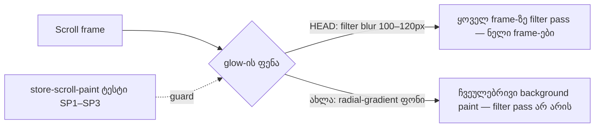

# SABA-B-15: მთავარი გვერდის scroll — blur glow-ები radial gradient-ით

**თარიღი:** 2026-11-12
**სტატუსი:** Completed (C round 470 PASS)
**შეცვლილი პროექტი:** Store (2 კომპონენტი, 1 ახალი ტესტ ფაილი, ეს დოკუმენტი)

## კონტექსტი

საბამ (SABA-B-15) შენიშნა, რომ Store-ის გვერდების scroll არ არის რბილი და გლუვი. Round 468-მა მიზეზი cloud-ის software raster-ში (SwiftShader) დაადასტურა: მთავარ გვერდზე სამი დიდი `filter: blur()` glow ყოველ scroll frame-ზე თავიდან იხატება.

- `ProductSection`-ის ორი glow (blur 120px და 100px) იწვევს ნელი frame-ების ზოლს scrollY ≈ 360–900-ზე.
- `StudioShowcase`-ის ერთი glow (blur 120px) იწვევს ზოლს scrollY ≈ 1850–2020-ზე.

**შეზღუდვა:** ყველა გაზომვა software raster-შია. საბას რეალურ მოწყობილობაზე (GPU raster) შედეგი ჯერ დადასტურებული არ არის. `/free-downloads`, რომელიც საბამ დაასახელა, აქ HEAD-ზეც 0 ნელ frame-ს აჩვენებს და ამ round-ში არ შეცვლილა.

## მიდგომა

blur-ით გაფანტული ფერადი წრე შეიცვალა იმავე ადგილზე მდგარი `radial-gradient` ფონით. gradient ჩვეულებრივი ფონია: მას filter pass არ სჭირდება და scroll-ისას იაფად იხატება. პოზიცია და `size` უცვლელია. `scale` წრეს ზრდის, რომ რბილი კიდე blur-ის გავრცელებას დაემთხვეს. opacity-ის stop-ები შეირჩა ისე, რომ glow-ის სიძლიერეც და ფორმაც დღევანდელს უდრიდეს.

**საბოლოო კლასები (sketch s6, round 470):**

- `ProductSection`, brand glow — `scale-160 … bg-radial from-brand/6 via-brand/3 via-30% to-transparent to-60%`.
- `ProductSection`, accent glow — `scale-180 … bg-radial from-accent/5 via-accent/2 via-25% to-transparent to-60%`.
- `StudioShowcase`, ambient glow — `scale-145 … bg-radial from-brand/20 via-brand/12 via-35% to-transparent to-70%`.

**სიძლიერის წესი (R-469-1, product-designer):** glow-ის წვლილი არის სექციის საშუალო luminance-ს მინუს HEAD build glow-ების გარეშე. ყოველი სექციისა და viewport-ისთვის ის HEAD-ის წვლილის 0.8×–1.3× უნდა იყოს.

**ფორმის წესი (R-470-1, product-designer):** მხოლოდ საშუალო არ კმარა — glow-მა დღევანდელი ფორმაც უნდა შეინარჩუნოს. სექცია იყოფა 7×7 ბადედ (40×40 patch-ები):

- **ნათელი patch-ები** — ყოველ patch-ზე, სადაც HEAD-ის glow დამალულ control-ზე ≥ 2 დონით ნათელია, ახალი glow HEAD-ის 0.7–1.3×-ია.
- **patch delta** — არც ერთი patch HEAD-ისგან 1.5 დონეზე მეტად არ განსხვავდება.
- **lean** — არც ერთ სექციაში ყველა შეცვლილი patch (|Δ| ≥ 0.05) ერთი მიმართულებით არ იწევს, როცა სექციის ფარდობა 0.9–1.1-ის გარეთაა.

**R-470-2 (tech-lead):** gradient-ის არც ერთი stop 70%-ს არ სცდება. კვადრატულ ყუთში farthest-corner-ის ჩახაზული წრე დაახლოებით 70.7%-ზეა, ამიტომ უფრო გვიანი stop `rounded-full` კიდეზე მოიჭრებოდა.

**უარყოფილი ვარიანტები:**

- **glow-ების წაშლა** — ყველაზე იაფია, მაგრამ ვიზუალს ცვლის. look change საბას გადაწყვეტილებაა.
- **round 468-ში A-ს უფრო ძლიერი opacity-ები** — გაზომვით 2.4–3.1× ძლიერი იყო HEAD-ზე. product-designer-მა უარყო.
- **round 469-ის sketch (s0)** — საშუალო ზოლში იყო, მაგრამ glow უფრო ბრტყელი და ფართო გამოვიდა (C-R469-01).
- **Lenis-ის მრუდის შეცვლა** — R-468-1-ით `duration: 1.2` უცვლელი რჩება. ნელი frame-ების მიზეზი paint-ია და არა easing.
- **glow-ის layer-ად აწევა (`will-change`, `transform-gpu`)** — round 468-ის s5 ეკრანმა frame-ები დაახლოებით 10×-ით გააუარესა, რადგან compositor-ი filter-ს ყოველ frame-ზე იყენებს. R-469-2 ამას კრძალავს.

## არქიტექტურა

## შეცვლილი ფაილები

- `app/components/home/ProductSection.tsx` — ორი glow ელემენტი: blur ფონის ნაცვლად radial gradient და scale.
- `app/components/home/StudioShowcase.tsx` — ერთი ambient glow ელემენტი, იგივე ცვლილებით. reflection-ის პატარა blur (40px) უცვლელია.
- `app/lib/__tests__/store-scroll-paint.test.ts` — ახალი static scan guard, რომელიც მთავარი გვერდის სექციებში დიდ blur-ებს ითვლის.
- `docs/implementation/2026/quarter-IV/305-saba-b-15-home-scroll-glows.md` — ეს დოკუმენტი.

უცვლელი რჩება: `useSmoothScroll.ts` (Lenis), `root.tsx`, `app/styles/**`, keep-list-ის `SpecialOffersSection` და `NewsletterSection`.

## პრობლემები და გადაწყვეტები

- **პრობლემა:** მთლიანი სექციის pixel diff-მა round 468-ში 2.4–3.1×-ით ძლიერი glow „ოდნავ უფრო ნათლად“ შეაფასა, რადგან საშუალო სხვაობა დაახლოებით 1/255 იყო. **გადაწყვეტა:** control-ად გამოიყენება HEAD build დამალული glow-ებით და იზომება glow-ის წვლილის ფარდობა (ორმხრივი ზოლი 0.8–1.3).
- **პრობლემა:** guard-ი არ უნდა ერეოდეს დიდ blur-ებს, რომლებიც ჯერ არ გაზომილა (Newsletter, keep-list SpecialOffers). **გადაწყვეტა:** ტესტს აქვს ზუსტი allow-list HEAD-ის რაოდენობებით (1 და 2), მიზეზით SIG-R469-UNMEASURED-BLURS. ახალი დიდი blur ან რაოდენობის ცვლილება ტესტს აწითლებს.
- **პრობლემა:** ტესტი ახალ gradient კლასებს რომ ამოწმებდეს, STORE-2d/3-ის restyle-ს ტყუილად ჩააგდებდა. **გადაწყვეტა:** ტესტი მხოლოდ დიდი blur-ის არარსებობას ამოწმებს და კონკრეტულ კლასებს არ აფიქსირებს.

## ტესტირება

**Unit (`store-scroll-paint.test.ts`):**

- **SP1** — `components/home/`-ში ≥ 80px blur-ის რაოდენობა allow-list-ს ზუსტად ემთხვევა.
- **SP2** — `ProductSection` და `StudioShowcase` 0 დიდ blur-ს შეიცავს.
- **SP3** — სკანი არ არის ცარიელი: ყოველი სიაში მოცემული ფაილი სკანირდება. მთვლელი ერთმანეთისგან არჩევს 80px და მეტ, 80px-ზე ნაკლებ და `backdrop-blur` კლასებს.

ქვემოთ დასახელებული ფაილები Studio loop-ის საქაღალდეშია (`tmp/studio-real-loop/`), store repository-ის გარეთ. B-მ ეს ტესტი round 469-ის დაგეგმვისას sketch-ზე გაუშვა. mutant-ზე (HEAD-ის ორი სექციის ფაილი) SP1 და SP2 წითლდება (`b-round-468/sp-mutant-head.log`).

**ბრაუზერის გაზომვები:** ეს რიცხვები B-ის გაზომვებია sketch s6-ზე (round 470-ის დაგეგმვა, production build) და არა C-ის შედეგი.

- look band (R-469-1) — სექციის ფარდობა 1.21 / 0.94 (1440), 1.18 / 0.94 (1280).
- ნათელი patch-ები (R-470-1) — 0.78–1.08. round 469-ის s0-ზე product სექციაში 0.43–0.63 იყო.
- max patch delta (R-470-1) — 0.54–0.78. s0-ზე 2.64–2.77 იყო.
- lean (R-470-1) — შერეული მიმართულება (+16/−7, +15/−8, +13/−2, +9/−8).
- edge jump — ზედა/ქვედა ≤ HEAD + 1 (PS 0/1, SS 1.67/0; HEAD PS 1/0.33, SS 1/0).
- frozen scroll probe (`b-round-467/probe/store-scroll-probe.cjs`) — `/`: p95 ≤ 16.8 ms 6/6 pass-ში, 33 ms-ზე ნელი frame-ების მედიანა 0 / 0, finalY 2400. `/free-downloads` — 0.
- full-page probe (`b-round-468/store-scroll-probe-full.cjs`) — `/`-ის მედიანა 0 / 0, finalY = max. `/gift-cards` — 0.
- HEAD control იმავე runner-ზე — `/`: p95 ≥ 33.0 ms 6/6 pass-ში.
- unit SP1–SP3 s6-ზე — 3 passed.

round 469-ის C1 control-ი > 33.4 ms frame-ებს ითვლიდა, რასაც ეს runner ვერ აღწევს (HEAD ნელ frame-ებს ზუსტად 2 vsync-ზე, 33.2–33.3 ms-ზე აგდებს), ამიტომ control ახლა p95-ით იზომება.

ბრაუზერის საბოლოო დადასტურებას C round 470 აკეთებს (C1–C13).

## TODO / შემდეგი ნაბიჯები

- **TLM-R468-SABA-SCROLL-DEVICE** — საბას რეალურ მოწყობილობაზე scroll-ის შემოწმება (GPU raster). SABA-B-15 მხოლოდ მისი პასუხის შემდეგ დაიხურება (deadline RETRO 480).
- **SIG-R469-UNMEASURED-BLURS** — `NewsletterSection`-ის (1) და `SpecialOffersSection`-ის (2) დიდი blur-ები ჯერ არ გაზომილა. SpecialOffers keep-list-შია, ამიტომ მისი restyle მხოლოდ საბას თანხმობით.
- **SIG-R470-STOP-CEILING** — gradient-ის stop-ები ≤ 70%-ზე რჩება (R-470-2). მომავალმა restyle-მა ეს ზღვარი უნდა დაიცვას, თორემ glow `rounded-full` კიდეზე მოიჭრება.
