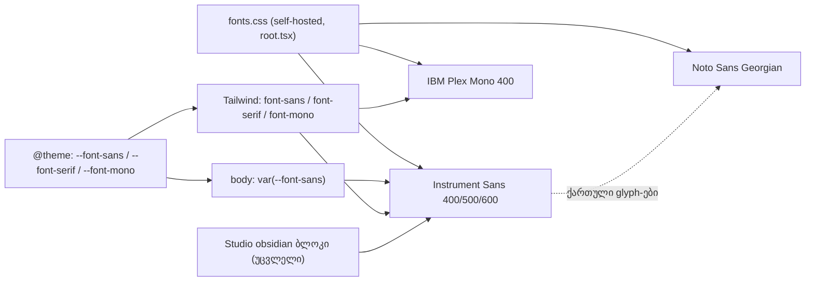

# STORE-2c-1: Store-ის font family token-ები (Instrument Sans / IBM Plex Mono)

**თარიღი:** 2026-11-12
**სტატუსი:** In Progress (stage 1 of 4; C round 473 PASS)
**შეცვლილი პროექტი:** Store (`app.css`-ის typography token-ები, 1 ტესტ ფაილი, ეს დოკუმენტი)

## კონტექსტი

Store redesign-ის spec-ის (l.9) დაპირება: Store-სა და Studio-ს ერთი პალიტრა და ერთი type system აქვთ.

- UI-ის შრიფტია Instrument Sans.
- რიცხვებისთვის IBM Plex Mono გამოიყენება.
- Fallback არის Noto Sans Georgian.
- Display serif არ არის.

Store-ის `@theme` ჯერ კიდევ Inter-სა და Playfair Display-ს ასახელებდა, ხოლო `body` rule-ს Inter-ის საკუთარი stack ჰქონდა. Studio-ს obsidian ბლოკში უკვე Instrument Sans და Plex Mono იყო.

რატომ ახლა:

- PERF-7-მა ყველა face უკვე self-host-ზე გადაიტანა.
- `root.tsx` `fonts.css`-ს გლობალურად ტვირთავს.
- ამიტომ შრიფტის ჩატვირთვაზე `root.tsx`-ის ძველი დამოკიდებულება აღარ არსებობს.
- `root.tsx` მხოლოდ Lenis-ის reduced-motion ნაწილისთვისაა საჭირო, ის კი STORE-2d-ში შედის.

## მიდგომა

- **R-471-1: Store-ის stack ზუსტად Studio-ს obsidian stack-ის ტოლია.**
  - `--font-sans` და `--font-serif` ორივე `'Instrument Sans', 'Noto Sans Georgian', system-ui, sans-serif`-ია.
  - ახალი `--font-mono` obsidian ბლოკის Plex Mono stack-ს იმეორებს.
  - `body`-ის `font-family` ახლა `var(--font-sans)`-ია: მეორე, ხელით დაწერილი stack აღარ არსებობს.
  - `--font-serif` ჯერ არ იშლება, რადგან 45 `font-serif` კლასი 2c-2-მდე რჩება. ეს კლასები ახლა იმავე sans stack-ზე მიდიან.
- **R-471-2: reflow-ის წესი.** Instrument Sans Inter-ზე ვიწროა, ამიტომ პარაგრაფები (`p`, `li`, `dd`) შეიძლება ორივე მიმართულებით გადალაგდეს. ისინი სიაში იწერება და FAIL არ არის. მიღებულია ზუსტად სამი ზრდა, სამივე 375-ზე:
  - `/about`-ის h1 "Crafting Sound for Cinema": 2 → 3 ხაზი;
  - `/`-ის h3 "The Complete Collection": 1 → 2;
  - `/about`-ის stat label "Sounds Delivered": 1 → 2.

  heading-ის ან ერთხაზიანი control-ის ნებისმიერი სხვა ზრდა, ახალი clipped ელემენტი ან horizontal overflow FAIL-ია.
- **R-471-3: legacy `/studio/<handle>` route ახალ შრიფტებს cascade-ით იღებს.** დაცული ფაილი არ იცვლება. ეს product-designer-ის default-ია, ხოლო ვიზუალური გაყინვის საკითხი საბასთან Q1-ად დაისვა.
- **STORE-2c-ის დაყოფა (product-designer, `pd-2c.md`):**
  - **2c-1:** family token-ები (ეს რაუნდი);
  - **2c-2:** display weight 500, ზომის მიხედვით tracking, body 17/1.5, caption-ის ფერები და `font-serif`/`font-bold` heading-ების sweep;
  - **2c-3:** Plex Mono metadata;
  - **2c-4:** Inter-ისა და Playfair-ის ფაილების, OFL ლიცენზიებისა და notice-ების წაშლა.
- **უარყოფილი ვარიანტები:**
  - family-ს შეცვლა და display scale ერთ რაუნდში. ეს დაახლოებით 28 ფაილს ეხება და ცუდ screenshot-ს ერთ ცვლილებამდე ვერ მივადევნებდით.
  - Playfair-ის დატოვება 2c-2-მდე. ორი family უფრო დიდხანს იარსებებდა ერთად.
- **შუალედური მდგომარეობა (მაქსიმუმ 3 რაუნდი):** heading-ები ამჟამინდელ ზომასა და weight-ს ინარჩუნებენ.
  - Instrument Sans მხოლოდ 400/500/600 weight-ებს აწვდის, ამიტომ ლათინური 700-ის მოთხოვნა 600-იანი face-ით უნდა დარენდერდეს, ყალბი bold-ის გარეშე. C-ის round 472-ის C5-მა browser-ში დაადასტურა, რომ ლათინური 700 600-იანი face-ით იხატება, ყალბი bold-ის გარეშე.
  - Noto Sans Georgian მხოლოდ 400/500-ს აწვდის, ამიტომ ქართული bold ტექსტი ყალბი bold-ით იხატება. Store-ის UI-ში დღეს ქართული ტექსტი არ არის (D-29z1663): store-ის route-ებსა და კომპონენტებში ქართული დამწერლობის UI სტრიქონი 0-ია, ყველა დამთხვევა კომენტარია.
  - `font-light` (300) 400-ზე გადადის.
  - Plex Mono მხოლოდ 400-ს აწვდის.
- **Inter და Playfair დისკზე რჩება 2c-4-მდე,** მაგრამ მათ აღარაფერი ითხოვს.

## არქიტექტურა

## შეცვლილი ფაილები

- `app/styles/app.css`:
  - Store-ის `@theme`-ის typography ხაზები: `--font-sans` და `--font-serif` შეიცვალა, ახალი `--font-mono` დაემატა;
  - `body` rule-ის `font-family` ხაზი.

  Obsidian ბლოკი byte-ით უცვლელია.
- `app/lib/__tests__/self-hosted-fonts.test.ts`:
  - ახალი `TOKEN_FONT_FAMILIES`, `INSTRUMENT_SANS_STACK` და `STORE_THEME_FONT_TOKENS` კონსტანტები;
  - FN4 ახლა მხოლოდ კომენტარებისგან გასუფთავებული Store-ის `@theme {` ბლოკის `--font-sans`/`--font-serif`/`--font-mono`-ს ზუსტ მნიშვნელობებს (R-471-1) ამოწმებს, მათ family-ებს ზუსტ სიას უტოლებს და ამოწმებს, რომ თითოეული self-hosted სიაშია; obsidian ბლოკს არ კითხულობს;
  - ახალი FN6.
- `docs/implementation/2026/quarter-IV/306-store-2c-1-font-family-tokens.md`: ეს დოკუმენტი.

## პრობლემები და გადაწყვეტები

- **პრობლემა:** HEAD-ის FN4 token family-ებს self-hosted family-ების სრულ სიას უტოლებდა. family-ის ცვლილებაზე ის წითლდებოდა, რადგან Inter და Playfair self-hosted სიაში 2c-4-მდე რჩება.
  **გადაწყვეტა:** FN4 ახლა token-ების ზუსტ სიას (IBM Plex Mono, Instrument Sans, Noto Sans Georgian) ამოწმებს. ამის გარდა ამოწმებს, რომ თითოეული მათგანი self-hosted სიაშია.
- **პრობლემა (A-R471-REVIEW-M1 / C-R471-01):** round 471-ის FN4 მთელ ფაილს სკანავდა, obsidian ბლოკი კი იმავე სამ family-ს შეიცავს. ამიტომ Store-ის `@theme` token-ის რეგრესიას FN4 ვერ ამჩნევდა: `--font-mono` ხაზის წაშლით ან `--font-serif: Georgia, serif`-ით mutant-ი 4 covering ფაილს 126/126-ით გადიოდა.
  **გადაწყვეტა (D-29z1662):** FN4 ახლა მხოლოდ კომენტარებისგან გასუფთავებულ Store-ის `@theme {` ბლოკს კითხულობს და სამი token-ის (`--font-sans`, `--font-serif`, `--font-mono`) ზუსტ მნიშვნელობებს R-471-1-ის მიხედვით ამოწმებს. Obsidian ბლოკს ST4 და TH2 იცავენ.
- **პრობლემა:** `body`-ის ხელით დაწერილ stack-ს token-ის ცვლილება არ შეეხებოდა.
  **გადაწყვეტა:** `body` ახლა `var(--font-sans)`-ს იყენებს. FN6 ამას ამოწმებს და იმასაც, რომ `app.css`-ში არც Inter წერია, არც Playfair Display, არც ერთმაგი, არც ორმაგი ბრჭყალებით.

## ტესტირება

- **Unit (A, round 472):** 4 covering ფაილი (`self-hosted-fonts`, `store-theme-tokens`, `studio-theme-obsidian`, `third-party-licenses`) — 126 passed. `npm run typecheck` და `npm run lint` — rc 0.
- **FN4 (sketch-472):** კომენტარებისგან გასუფთავებულ `app.css`-ში სტრიქონი `\n@theme {` ზუსტად ერთხელ უნდა გვხვდებოდეს, ბლოკი კი `\n}`-ით იხურება. FN4 მხოლოდ ამ ბლოკის `--font-sans`/`--font-serif`/`--font-mono` მნიშვნელობებს უტოლებს R-471-1-ის stack-ებს (`STORE_THEME_FONT_TOKENS`). ამ token-ების family-ები ზუსტად `TOKEN_FONT_FAMILIES`-ია, თითოეული self-hosted სიაშია, face და OFL ლიცენზია აქვს. Obsidian ბლოკს FN4 არ კითხულობს.
- **FN6 (sketch-472):** `body` rule-ის `font-family` არის `var(--font-sans)` (whitespace დასაშვებია მხოლოდ `body`-სა და `{`-ს შორის და `:`-ის შემდეგ; `body` ხაზის დასაწყისშია); `app.css`-ში არც Inter წერია, არც Playfair Display, არც ერთმაგი, არც ორმაგი ბრჭყალებით.
- **Mutant (B, sketch-472-ზე, `b-round-471/mutants-summary.txt`):** control — 6 passed; `georgia-serif`, `no-mono`, `commented-mono`, `theme-unterminated` — FN4 წითელი; `sans-inter` და `head-css` — FN4 და FN6 წითელი; `body-dq-inter` — FN6 წითელი; `obsidian-sans-georgia` ამ ფაილში მწვანეა, ST4 და TH2 კი თავიანთ ფაილებში წითლდება (`b-round-471/mutant-obsidian-sans-georgia-siblings.log`: 2 failed, 48 passed).
- **Browser-ის გაზომვები (B, sketch-ის production build-ზე, 8 გვერდი × 1440/1280/375):**
  - overflow 24/24-ზე 0-ია;
  - font response-ებში მხოლოდ `instrument-sans-latin` და `ibm-plex-mono-latin` ჩანს, ყველა 200, Inter-ისა და Playfair-ის მოთხოვნა არ არის;
  - h1-ის CDP platform font 24/24-ზე Instrument Sans-ია;
  - პირველი heading-ის სიმაღლე მხოლოდ `/about`-ზე, 375-ზე იცვლება (+48);
  - CLS sketch-ზე ≤ 0.0216, HEAD-ზე ≤ 0.0221;
  - გრძელი სათაურის ხაზების რაოდენობა HEAD-ის ტოლია;
  - glyph probe-ში ქართული glyph-ები Noto Sans Georgian-ით იხატება.
- **დამოუკიდებელი browser შემოწმება:** C, round 472.

## TODO / შემდეგი ნაბიჯები

- **2c-2:** 2c-1-დან არაუგვიანეს 3 რაუნდისა. display weight 500 და tracking, body 17/1.5, caption-ის ფერები, `font-serif`/`font-bold` heading-ების sweep. ამ ეტაპზე R-471-2-ის სამი ზრდა ხელახლა უნდა გაიზომოს.
- **2c-3:** Plex Mono metadata (uppercase, tracking, `tabular-nums`).
- **2c-4:** Inter-ისა და Playfair-ის ფაილების, OFL ლიცენზიებისა და notice-ების წაშლა; FN/TL row-ების განახლება.
- **საბა Q1:** უნდა გაიყინოს თუ არა legacy `/studio/<handle>` route-ის ვიზუალი.
- **2c-2:** `app.css`-ის `.artist-title { font-family: var(--font-serif) }` sweep-ის სიაშია; `--font-serif` 2c-4-ში მხოლოდ მისი მოშორების შემდეგ წაიშლება.
- **2c-3:** CommandPalette-ის `<kbd>` chip-ები Plex Mono-ს preflight-ით იღებს, ↵ (U+21B5) სხვა შრიფტით იხატება; Plex Mono-ს სიგანე Consolas-თან (A-R471-REVIEW-INFO-COVERAGE).
- **2c-4:** SR-472-L1 (font override `@theme`-ის გარეთ) და SR-472-L2 (ბრჭყალების გარეშე `Inter`) FN/TL row-ების გადაწერაში; Inter-ის ფაილების წაშლისას Cyrillic-ისა და Greek-ის დაფარვის დაკარგვის აღრიცხვა (A-R471-REVIEW-INFO-COVERAGE).
