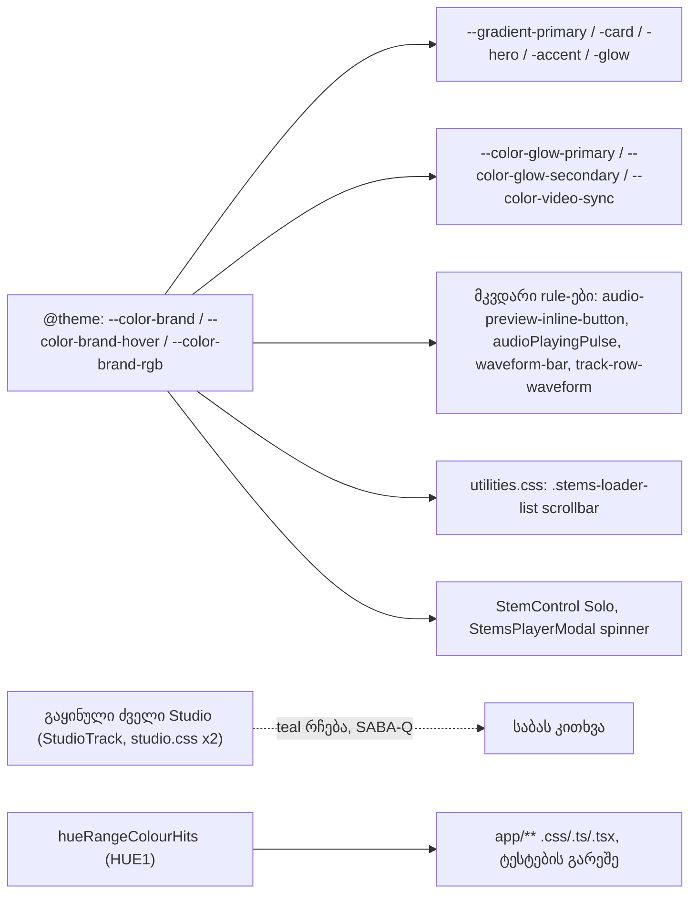

# DPG-P0-1: Store-ში teal აღარ რჩება, gradient და glow token-ები brass-ზე

**თარიღი:** 2026-11-12
**სტატუსი:** Completed (C round 478 PASS)
**შეცვლილი პროექტი:** Store (`app.css`, `utilities.css`, 2 audio კომპონენტი, 3 ტესტ ფაილი, ტესტების helper, ეს დოკუმენტი)

## კონტექსტი

2026-11-12-ის დიზაინის gate-მა (design-philosopher 3.5/10, product-designer 4/10) ერთი ძირითადი მიზეზი დაასახელა: Obsidian & Brass token-ები უკვე შემოსულია, მაგრამ კოდში ძველი teal (`#13d9cc`, `hsl(175, 85%, …)`, `rgba(19, 217, 204, …)`) ჯერ კიდევ რჩება. ამის გამო პროდუქტს ორი იდენტობა აქვს. საბამ DPG-FIX P0 ბლოკი ყველა სხვა სამუშაოზე წინ დააყენა.

B-მ P0 სამ ეტაპად გაყო (D-29z1674):

- **P0-1 (ეს რაუნდი):** teal, gradient და glow token-ები და გამოუყენებელი დეკორატიული token-ები;
- **P0-2:** განუსაზღვრელი token-ები (`--primary-hue`, `--radius-xs`, `--color-text-primary`, ProductCard-ის `bg-primary`);
- **P0-3:** SpotlightLoader და დიზაინის დოკუმენტები.

## მიდგომა

- **teal ადგილზევე იცვლება brass token-ის მითითებით (D-29z1675).** მკვდარი rule-ები არ იშლება. ისინი LEGACY-DEAD სიაში რჩება, ხოლო ფერი ხდება `rgba(var(--color-brand-rgb), …)` ან `var(--color-brand-hover)`. საბას ტექსტი პირდაპირ "brass token references"-ს ითხოვს.
- **ხუთი gradient და ორი glow token თავიდან განისაზღვრა** მხოლოდ `var(--color-…)`-ით და brass rgba-თი. ორი token შეგნებულად ერთმანეთს დაემთხვა:
  - `--gradient-accent` ახლა `--gradient-primary`-ის ტოლია (ორივე brass-hover → brass);
  - `--color-glow-secondary` ნარინჯისფერიდან `--color-brand-hover`-ზე გადავიდა.

  ცალკე accent ფერი Obsidian & Brass პალიტრაში არ არსებობს, ამიტომ მეორე ტონი brass-ის hover ვარიანტია.
- **`--color-video-sync`** `#14b8a6`-დან `var(--color-brand)`-ზე გადავიდა.
- **შვიდი დეკორატიული token (`--color-crystal-*`, `--color-premium-*`) წაიშალა.** მათ კოდში არცერთი მკითხველი არ ჰყავდა. ეს DPG-DECORATIVE-PURGE-ის token-ის ნაწილია, წინ წამოწეული.
- **StemControl-ის Solo ღილაკი** აქტიურ მდგომარეობაში Tailwind-ის teal palette-ის fill-იდან (`text-foreground`-ით) `bg-brand text-background`-ზე გადავიდა. StemsPlayerModal-ის spinner `text-brand`-ია. მოდალი დღეს ვერასდროს გაიხსნება (`createDisplayVersions` `stems`-ს არ ავსებს, D-29z1676), ამიტომ ეკრანზე არაფერი იცვლება.
- **ერთადერთი ცოცხალი ვიზუალური ცვლილება ძველ Studio-შია:** `utilities.css`-ის `.stems-loader-list`-ს `StemsLoadingAnimation` იყენებს ნაყიდი ტრეკის route-ზე (`/studio/$productId`, საჭიროებს sign-in-ს). მისი scrollbar-ის thumb teal-იდან brass-ზე გადადის. Store-ის საჯარო გვერდებზე არაფერი იცვლება. ეს B-მ task-ში წინასწარ დაასახელა. C-ის C6 rule-ს ამოწმებს inject-ებულ ელემენტზე, რადგან თავად გვერდი backend-ს საჭიროებს.
- **გაყინული ძველი Studio-ს teal რჩება და სიაშია**, არ იცვლება: `components/studio/StudioTrack.tsx` (1) და `.slider-thumb-teal` ორივე `studio.css` ასლში (4 + 4). ეს საბასთვის კითხვაა: SABA-Q-DPG-LEGACY-STUDIO-TEAL.
- **ახალი სკანერი ფერის ტონის (hue) მიხედვით მუშაობს და არა ზუსტი მნიშვნელობების სიით.** ძველი `countTealHits` მხოლოდ ცნობილ teal მნიშვნელობებს პოულობდა. ახალი `hueRangeColourHits` ყოველ ფერის ჩანაწერს HSL-ზე გადაიყვანს და ამოწმებს: hue 160–200°, saturation ≥ 25 %, lightness 12–90 %. სინტაქსები: hex (3/4/6/8), `rgb`/`rgba` (მძიმით, სივრცით და Tailwind-ის `_`-ით), `hsl`/`hsla` (`deg`-ითაც), `oklch`, `hwb`, CSS-ის სახელიანი ფერები (კომენტარის გარეთ) და Tailwind-ის `teal`/`cyan`/`emerald`/`sky` palette კლასები.
  - Tailwind-ის arbitrary მნიშვნელობაში `_` სივრცის ნაცვლად დგას, ამიტომ `_` ფერის საზღვარს არ ბლოკავს: `shadow-[0_0_12px_#…]` ფორმაც ითვლება.
  - URL fragment (`href="#…"`, `url(#…)`) და HTML entity (`&#…;`) ფერად არ ითვლება. `to="#…"` ითვლება, რადგან SVG-ის `<animate to=…>` ფერს შეიცავს.
  - palette-ის ოთხი family მთლიანად ითვლება, თითო shade-ის hue-ს შემოწმების გარეშე. ეს ზღვარზე ოდნავ მკაცრია (მაგ. `emerald-400`-ის hue 158°-ია) და შეგნებულია.
- **უარყოფილი ვარიანტი:** მკვდარი rule-ების წაშლა ამ რაუნდში. ეს LEGACY-DEAD-ის ცალკე სამუშაოა, ხოლო tech-lead-მა ადგილზე ჩანაცვლება დაამტკიცა.

## არქიტექტურა

## შეცვლილი ფაილები

- `app/styles/app.css`: შვიდი დეკორატიული token წაიშალა; glow, `video-sync` და ხუთი gradient token თავიდან განისაზღვრა; 7 `rgba(19, 217, 204, …)` და ერთი `hsl(175, 85%, 65%)` მკვდარ rule-ებში brass token-ზე გადავიდა. Obsidian ბლოკი უცვლელია.
- `app/styles/base/utilities.css`: `.stems-loader-list`-ის scrollbar-ის სამი მნიშვნელობა brass rgba-ზე.
- `app/components/audio/StemControl.tsx`: Solo-ს აქტიური კლასი.
- `app/components/audio/StemsPlayerModal.tsx`: spinner-ის კლასი.
- `app/lib/__tests__/helpers/style-scan.ts`: ახალი export `hueRangeColourHits`. არსებული export-ები უცვლელია.
- `app/lib/__tests__/store-teal-sweep.test.ts`: StemControl და StemsPlayerModal allow-list-იდან teal-free სიაში გადავიდა; ახალი HUE1, HUE2, HUE3.
- `app/lib/__tests__/store-live-teal.test.ts`: `app.css` და `utilities.css` allow-list-ებიდან ამოვიდა; ახალი LT11; LT4-ს `app.css`-ის სკანირების შემოწმება დაემატა; LT7 შეიცვალა.
- `app/lib/__tests__/store-theme-tokens.test.ts`: ST3 29 key-ს ამოწმებს; ახალი ST3b და GR1.
- `docs/implementation/2026/quarter-IV/307-dpg-p0-1-teal-purge-brass-tokens.md`: ეს დოკუმენტი.

## პრობლემები და გადაწყვეტები

- **პრობლემა:** ძველი LT7 ითხოვდა, რომ მინიმუმ 5 "dead" teal rule დარჩენილიყო. ჩანაცვლების შემდეგ ასეთი აღარ არის, ამიტომ ტესტი წითლდებოდა.
  **გადაწყვეტა:** LT7 ახლა ამოწმებს, რომ "dead" teal rule აღარ რჩება და `@theme`-ში teal დეკლარაცია 0-ია. ძველი შემოწმებები არ დაკარგულა: brass-ზე გადაყვანილი მკვდარი rule-ები ისევ არსებობს და მათ ისევ არ ჰყავთ mount-ებული მომხმარებელი. ხუთი ყოფილი teal token კი ახლა `var(--color-brand…)`-ს კითხულობს. ეს ეკრანის უცვლელობის გარანტიაა: თუ ეს rule-ები ცოცხალი გახდებოდა, brass გამოჩნდებოდა.
- **პრობლემა:** ST3 ითხოვდა, რომ ყველა გამონაკლისი key `@theme`-ში ყოფილიყო. შვიდი დეკორატიული key წაიშალა.
  **გადაწყვეტა:** ისინი გამონაკლისების სიიდან ცალკე სიაში გადავიდა, ხოლო ST3b ამოწმებს, რომ ისინი აღარ არსებობს. glow-primary, glow-secondary და video-sync ახლა შემოწმებულ key-ებშია (26 → 29).
- **პრობლემა:** Tailwind v4-ის source scan რეპოს ყველა ფაილს კითხულობს, `docs/`-ისა და `__tests__`-ის ჩათვლით. ტესტის fixture-ში ან დოკუმენტში ჩაწერილი teal palette-ის ან arbitrary hex კლასი production CSS-ში teal utility-ს გამოიწვევს.
  **გადაწყვეტა:** კლასის ფორმის fixture-ები `.join('')`-ით იწყობა, როგორც TS6/TS7-ში. ეს დოკუმენტიც ასეთ კლასს სიტყვასიტყვით არ წერს. ძველ დოკუმენტებში (`docs/technical/components/*.md`, `.claude/primitives/TAILWIND_FIRST.md`) ჩაწერილი teal კლასები build-ის CSS-ში უკვე HEAD-ზეც იყო. ისინი ამ რაუნდის grant-ის გარეთაა და B-სთვის სიგნალად იწერება.
- **პრობლემა:** სახელიანი ფერის სიტყვა selector-ში (`.slider-thumb-teal`) ან კომენტარში (`// Cyan`) ფერი არ არის.
  **გადაწყვეტა:** სახელიანი ფერი მხოლოდ მაშინ ითვლება, როცა წინ ლათინური ასო, ციფრი, `$`, `-`, `.` ან `#` არ უდგას, და მხოლოდ კომენტარის გარეთ. HUE2 ორივე შემთხვევას negative fixture-ად ამოწმებს.
- **პრობლემა (code-reviewer, High):** სკანერის პირველ ვერსიაში საზღვარი `\w`-ით იყო განსაზღვრული. `\w` `_`-საც მოიცავს, ამიტომ Tailwind-ის `_`-იანი arbitrary მნიშვნელობის hex და სახელიანი ფერი გამოტოვებული იყო.
  **გადაწყვეტა:** საზღვარი ახლა მხოლოდ ასოს და ციფრს ბლოკავს. HUE2-ს სამი `_`-იანი fixture დაემატა, და mutant-მა (ძველი საზღვრის აღდგენა) HUE2 გააწითლა.
- **პრობლემა (code-reviewer, Medium):** LT7-ის `deadRuleKeys()`-ის შემოწმება ცარიელ კონსტანტებს კითხულობს და ვერასდროს ჩავარდება.
  **გადაწყვეტა:** LT7 ახლა ყოველ ყოფილ მკვდარ rule-ზე ცალკე ამოწმებს, რომ `countTealHits` 0-ია და hue-range სკანერი ცარიელ სიას აბრუნებს.

## ტესტირება

- **HUE1:** `app/**`-ის ყველა `.css`/`.ts`/`.tsx` (ტესტების გარეშე) სკანირდება. hue-range ფერი მხოლოდ გაყინულ სიაშია: `StudioTrack.tsx` 1, `styles/studio.css` 4, `styles/pages/studio.css` 4.
- **HUE2:** სკანერი ყველა ჩამოთვლილ ფორმას ზუსტად ერთხელ პოულობს. brass, ნეიტრალური ფერები, ნარინჯისფერი `hsl(38, …)`, selector-ის სიტყვა და კომენტარი 0-ს იძლევა.
- **HUE3:** `app.css`-ზე დამატებულ ერთ teal rgba ხაზს სკანერი ხედავს.
- **TS1/TS2/TS3:** StemControl და StemsPlayerModal teal-free სიაშია; allow-list-ში მხოლოდ `StudioTrack.tsx` დარჩა.
- **LT3/LT4/LT5/LT11:** `app.css` და `utilities.css` teal-ს აღარ შეიცავს; rule-ების allow-list ცარიელია.
- **LT7:** "dead" teal rule აღარ არის; ყოველ ყოფილ მკვდარ rule-ში teal და hue-range ფერი 0-ია; ყოფილ teal token-ებს brass მნიშვნელობა აქვს; მკვდარ rule-ებს mount-ებული მომხმარებელი არ ჰყავთ.
- **ST3/ST3b/GR1:** შემოწმებული 29 key; დეკორატიული key-ები აღარ არსებობს; ხუთი gradient მხოლოდ brass-ისა და obsidian-ის token-ებისგან (`brand`, `brand-hover`, `background`, `surface`, `elevated`), brass rgba-სგან, `transparent`-ისგან, keyword-ებისა და stop-ებისგან შედგება, ხოლო `--gradient-accent` `--gradient-primary`-ის ტოლია.
- **Mutant-ები (A):** HUE3, M-GR1, M-ST, M-TS და M-UNDERSCORE. თითოეული შესაბამის ტესტს აწითლებს. log-ები: `tmp/studio-real-loop/a-round-474/mutants/`.
- **კონტრასტი:** Solo-ს აქტიური მდგომარეობა, `text-background` (`#0e0d0c`) `bg-brand`-ზე (`#c9a46a`): 8.32:1 (WCAG relative luminance 0.4001 და 0.0041). ეს მხოლოდ გამოთვლაა: კომპონენტი browser-ში მიუწვდომელია.

## TODO / შემდეგი ნაბიჯები

- **DPG-P0-2:** განუსაზღვრელი token-ები (`--primary-hue`, `--radius-xs`, `--color-text-primary`, ProductCard-ის `bg-primary`/`text-primary-foreground`), დოკუმენტებით იმავე რაუნდში.
- **DPG-P0-3:** SpotlightLoader-ის პალიტრა და დიზაინის დოკუმენტები (`DESIGN_TOKENS.md`, `DESIGN_SYSTEM.md`, direction-decision), შემდეგ root-ის P0 re-review.
- **SABA-Q-DPG-LEGACY-STUDIO-TEAL:** ძველი Studio-ს teal დარჩეს SRW-21-მდე თუ brass-ზე გადავიდეს (საჭიროა root-ის grant დაცულ ფაილებზე).
- LEGACY-DEAD: brass-ზე გადაყვანილი მკვდარი rule-ები და StemsPlayerModal-ის მიუწვდომელი გზა ცალკე წასაშლელად.
