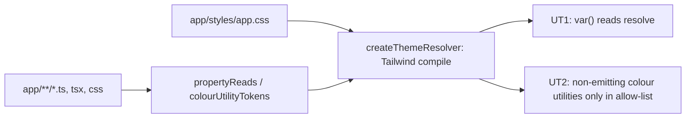

# DPG-P0-2: Store-ში ყველა გამოუცხადებელი token იხსნება, ბარათის badge-ს chip ეძლევა

**თარიღი:** 2026-11-12
**სტატუსი:** Completed (C round 478 PASS)
**შეცვლილი პროექტი:** Store (`app.css`, `ProductCard.tsx`, 2 stub route, 1 არსებული ტესტი, ახალი ტესტი და helper, ეს დოკუმენტი)

## კონტექსტი

2026-11-12-ის დიზაინის gate-ის (design-philosopher 3.5/10, product-designer 4/10) შემდეგ საბამ DPG-FIX P0 ბლოკი ყველა სხვა სამუშაოზე წინ დააყენა. P0-ის მეორე ეტაპი (DPG-UNDEFINED-TOKENS) ეხება CSS custom property-ებსა და Tailwind კლასებს, რომლებიც არსად არ არის გამოცხადებული. ასეთი წაკითხვა ბრაუზერში ჩუმად ცარიელდება: ელემენტი ან ფერს მემკვიდრეობით იღებს, ან მთელი declaration invalid ხდება და არაფერი იხატება.

საბას სიაში იყო `--color-text-primary`, `--radius-xs`, `--radius_full` და `bg-primary` / `text-primary-foreground`. ინვენტარი რეალური resolver-ით გაკეთდა, რომ grep-ის ნაცვლად ბრაუზერის შედეგს დაემთხვეს.

## მიდგომა

**ინვენტარი Tailwind-ის საკუთარი compiler-ით.** ორი სკანი (`b-round-474/scan/`) იყენებს `@tailwindcss`-ის compiler-ს:

| სკანი | HEAD (`297f5ae`) | ამ ცვლილების შემდეგ |
|---|---|---|
| fallback-ის გარეშე `var()` წაკითხვა გამოუცხადებელ property-ზე (არა-ტესტ `app/**`) | 14 | 0 |
| ფერის utility, რომელსაც Tailwind არ აგენერირებს | 28 | 24 |

დარჩენილი 24 მკვდარ ფაილებშია (18 `UserDropdown`-ში და glow-ის ნარჩენები, რომლებსაც რაუნდი 449/453-ის გადაწყვეტილება ტოვებს), გაყინულ `GlobalPlayhead`-ში და ერთ არა-კლას სტრიქონში (`border-color` `transition`-ის მნიშვნელობაში).

**საბას სია vs ხე:**
- `--radius-xs` გატეხილი არ არის: Tailwind-ის default theme მას `0.125rem`-ად აცხადებს და ბრაუზერი ხსნის. მას მხოლოდ მკვდარი `TrackRow` კითხულობს, ამიტომ უცვლელი რჩება.
- `--radius_full` HEAD-ზე 0 შემთხვევაა.
- სკანმა ორი სახელი იპოვა, რომელიც სიაში არ იყო: `--color-accent-hover` (`.nav-loading-bar`) და `--color-text-muted` (ორი stub route).

**product-designer-ის გადაწყვეტილებები** (`b-round-474/pd-p0-2.md`):
1. ბარათის არა-"New" badge: `bg-primary/90 text-primary-foreground` → `bg-background/70 text-foreground`. HEAD-ზე chip გამჭვირვალე იყო. Brass მხოლოდ "New"-ს რჩება (brass = მნიშვნელობა).
2. ბარათის სურათის wrapper: `bg-card` (გამოუცხადებელი) → `bg-surface`.
3. სათაურის hover `group-hover:text-primary` (no-op) და მისი `transition-colors` იშლება. Hover-ის სიგნალად ბარათის scale რჩება.
4. Navigation loading bar HEAD-ზე არაფერს ხატავს, რადგან გამოუცხადებელი `--color-accent-hover` მის `background`-ს invalid-ს ხდის. Token-ის რაუნდში მოციმციმე brass ზოლი არ ჩაირთვება. Render-ის ხაზი დაცულ `app/root.tsx`-შია, ამიტომ წესი ხდება `display: none;`, ხოლო `navLoadingProgress` keyframes იშლება. ხედი უცვლელია და layout-ს არაფერი იკავებს. ეს დროებითი მდგომარეობაა: render-ის ხაზს root მოგვიანებით წაშლის (ROOT-REQ-NAV-LOADING-BAR-RENDER).
5. Stub route-ები `/search` და `/account/login`: `var(--color-text-muted)` → `var(--color-muted)`.
6. `--color-text-primary` (CommandPalette-ისა და `.code-4`-ის 5 წაკითხვა) → `var(--color-foreground)`. B-მ გაზომა, რომ დღეს ყველა მომხმარებელი მემკვიდრეობით `#ece6da`-ს იღებს, ამიტომ ვიზუალური ცვლილება 0 px-ია.
7. მკვდარი `.artist-photo-border` / `.artist-photo-glow`: `hsla(var(--primary-hue), …)` → `rgba(var(--color-brand-rgb), …)`. ვარდისფერი stop რჩება DPG-DECORATIVE-PURGE-მდე (P2).

`@theme`-ში არც ერთი token არ დაემატა, არ წაიშალა და არ შეიცვალა, ამიტომ დიზაინის დოკუმენტაციის ცვლილება (DPG-ის წესი 2) ამ ეტაპზე საჭირო არ არის.

**უარყოფილი ალტერნატივა:** ახალი `--color-text-primary` / `--color-accent-hover` token-ების გამოცხადება. ეს მეორე სახელს შექმნიდა ერთი ფერისთვის და nav bar-ს მოულოდნელად გამოაჩენდა.

## არქიტექტურა

ტესტის helper (`helpers/token-resolve.ts`) Tailwind-ის compiler-ით აგებს store-ის theme-ს და ამოწმებს, რომელი property არის გამოცხადებული და რომელ კლასს აგენერირებს Tailwind.

## შეცვლილი ფაილები

- `app/styles/app.css` — `.nav-loading-bar` → `display: none;`, `navLoadingProgress` keyframes წაიშალა, `.artist-photo-*` brass rgba-ზე, 5 `--color-text-primary` → `--color-foreground`
- `app/components/product/ProductCard.tsx` — badge chip, `bg-surface` wrapper, სათაურის no-op hover წაიშალა
- `app/routes/search.tsx`, `app/routes/account_.login.tsx` — `--color-muted`
- `app/lib/__tests__/store-live-teal.test.ts` — `.code-4`-ის ერთი pin ხაზი
- `app/lib/__tests__/helpers/token-resolve.ts` — ახალი resolver helper
- `app/lib/__tests__/store-undefined-tokens.test.ts` — ახალი guard (UT1–UT5, UT2b)
- `docs/implementation/2026/quarter-IV/308-dpg-p0-2-undefined-tokens.md` — ეს დოკუმენტი

## პრობლემები და გადაწყვეტები

**Problem:** grep-ზე დაფუძნებული ინვენტარი ვერ ხედავს, რას ხსნის Tailwind-ის default theme (მაგ. `--radius-xs`).
**Solution:** სკანი და ტესტი Tailwind-ის compiler-ს იყენებს. B-ის HEAD probe-მა ბრაუზერში დაადასტურა, რომ `--radius-xs` იხსნება (`0.125rem`).

**Problem:** Nav loading bar-ის render-ის ხაზი დაცულ `app/root.tsx`-შია.
**Solution:** CSS წესი `display: none;` ხდება. Render-ის წაშლა root-ის მოთხოვნაა (ROOT-REQ-NAV-LOADING-BAR-RENDER), ხოლო pending-navigation feedback-ის საჭიროება საბასთან კითხვაა (SABA-Q-PENDING-NAV-FEEDBACK).

**Problem:** მკვდარ ფაილებში დარჩენილი გამოუცხადებელი კლასები ამ ეტაპის საზღვრებს გარეთაა.
**Solution:** UT2 მათ ზუსტი token სიით allow-list-ში ინახავს, UT2b კი ამოწმებს, რომ ეს ფაილები ისევ არ არის mount-ებული.

## ტესტირება

- `store-undefined-tokens.test.ts`:
  - **UT1:** fallback-ის გარეშე ყოველი `var()` წაკითხვა არა-ტესტ `app/**`-ში გამოცხადებულ property-ზე იხსნება.
  - **UT2:** ფერის utility, რომელსაც Tailwind არ აგენერირებს, მხოლოდ allow-list-ის მკვდარ, გაყინულ ან არა-კლას ფაილებშია, ზუსტი token-ებით.
  - **UT2b:** allow-list-ის მკვდარი ფაილები mount-ებული არ არის.
  - **UT3:** resolver-ის მიხედვით ჩამნაცვლებელ კლასებს Tailwind აგენერირებს, წაშლილებს კი არა; `--color-foreground` და `--color-muted` გამოცხადებულია. ბრაუზერთან შედარება B-ის probe-ებსა და C-ის browser row-ებშია, არა ამ ტესტში.
  - **UT4:** fixture-ები: დარღვეული და სუფთა შემთხვევები.
  - **UT5:** nav loading bar არაფერს ხატავს და animation აღარ აქვს.
- `store-live-teal.test.ts`, **LT1**: `.code-4`-ის pin `var(--color-foreground)`-ზე.
- A: `npm run typecheck`, `npm run lint`, 16 covering ფაილი და B-ის 11 mutant (ყველა წითელი) — `a-round-475/`.
- C: ბრაუზერში badge-ის ფერი და კონტრასტი, wrapper-ის ფონი, სათაურის hover, nav bar pending navigation-ისას, stub-ების ფერი და CommandPalette/404-ის უცვლელობა, ორივე viewport-ზე.

## TODO / შემდეგი ნაბიჯები

- **DPG-P0-3:** SpotlightLoader (SABA-B-16) და დიზაინის დოკუმენტაცია (`DESIGN_SYSTEM.md`, primitives root-ის გავლით)
- **SABA-Q-PENDING-NAV-FEEDBACK:** სჭირდება თუ არა CZABA-ს pending-navigation feedback (საბას კითხვა)
- **ROOT-REQ-NAV-LOADING-BAR-RENDER:** `app/root.tsx`-დან render-ის ხაზის წაშლა
- **LEGACY-DEAD:** მკვდარი ფაილების გაწმენდა (`UserDropdown` და glow-ის ნარჩენები)
- **Stub route-ები:** `/search` და `/account/login`-ის გადაწერა და მათი ტექსტი ცალკე დავალებაა
