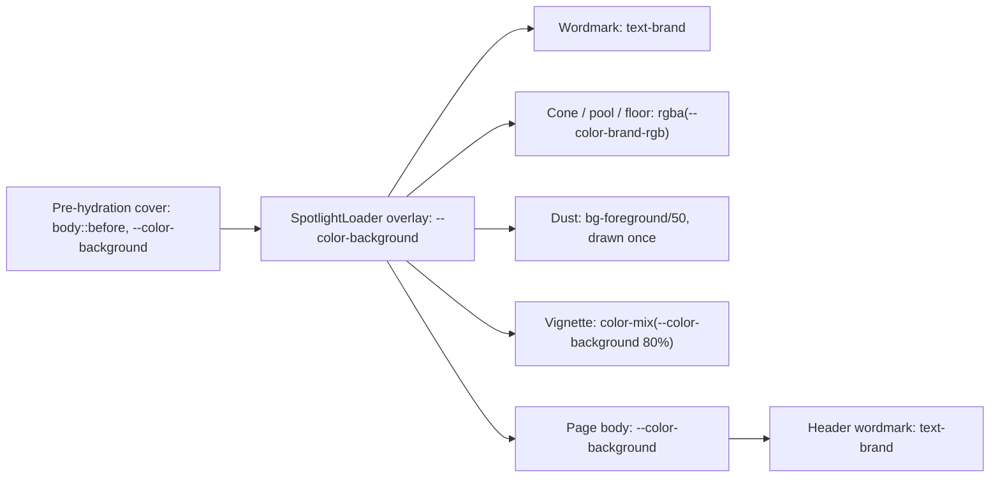

# DPG-P0-3a: შესასვლელი loader და header-ის ლოგო Obsidian & Brass-ში

**თარიღი:** 2026-11-12
**სტატუსი:** Completed (C round 478 PASS)
**შეცვლილი პროექტი:** Store (`SpotlightLoader.tsx`, `EntranceCover.tsx`, `Header.tsx`, 2 არსებული ტესტი, ეს დოკუმენტი)

## კონტექსტი

2026-11-12-ის დიზაინის gate-ის (design-philosopher 3.5/10, product-designer 4/10) შემდეგ საბამ DPG-FIX P0 ბლოკი ყველა სხვა სამუშაოზე წინ დააყენა. DPG-SPOTLIGHT-FIX ამბობს, რომ შესასვლელი ანიმაცია მომხმარებლის პირველი შთაბეჭდილებაა და brass პალიტრაში უნდა იყოს.

HEAD-ზე (`edeba5a`) loader-ს teal აღარ ჰქონდა, მაგრამ მისი სამყარო ცივი შავ-თეთრი იყო: `#000` ფონი, თეთრი სინათლის კონუსი, თეთრი მტვერი, `rgba(0,0,0,0.8)` vignette და ivory wordmark. Pre-hydration ფარდა `var(--color-black)`-ს კითხულობდა. გვერდის ფონი კი obsidian `#0e0d0c`-ია, ამიტომ hand-off-ზე ფერის საფეხური ჩნდებოდა. საბას შენიშვნა SABA-B-16 („ლოგო ძველ ფერებშია“) და DPG-LOGO (header-ის ლოგო brass-ში) იგივე ელემენტებს ეხება.

DPG-FIX P0 ახლა 4 ეტაპია: P0-1, P0-2, P0-3a (ეს დოკუმენტი) და P0-3b (დიზაინის დოკუმენტაცია). ეს ეტაპი მხოლოდ ფერს ცვლის.

## მიდგომა

**product-designer-ის გადაწყვეტილებები** (`b-round-475/pd-p0-3a.md`):

1. **Obsidian ფონი:** `var(--color-background)` სამ ადგილას: overlay-ის inline style, მისი base layer (`bg-black` → `bg-background`) და pre-hydration failsafe ფარდა (`ENTRANCE_COVER_CSS`). ფარდა, loader და გვერდი ერთ ფერს იზიარებენ. უარყოფილია `#000` (ცივი საფეხური) და `surface` (გვერდზე ღია).
2. **Brass სინათლე:** `rgba(var(--color-brand-rgb), a)`. Brass თეთრზე დაახლოებით ნახევრად ნათელია, ამიტომ alpha ოდნავ იზრდება: კონუსი 0.04 / 0.10 / 0.04, pool 0.18 / 0.06, იატაკის ნათება 0.12. უარყოფილია იგივე alpha-ები, რომლებიც ტალახიან, უხილავ სხივს ტოვებს.
3. **მტვერი:** ivory `bg-foreground/50`. უარყოფილია brass მტვერი (glitter-ად იკითხება) და თეთრი.
4. **Vignette:** `color-mix(in srgb, var(--color-background) 80%, transparent)`, რომ hand-off-ზე საფეხური არ გაჩნდეს.
5. **Wordmark:** loader-ში `text-brand`, `font-bold` რჩება. DPG-LOGO-ს header-ის ფერი ამ რაუნდში გადმოვიდა: `Header.tsx`-ის wordmark `text-foreground` → `text-brand`. მის გარეშე brass loader-ის ლოგო ivory header-ის ლოგოში გადავიდოდა. Footer-ის ლოგო უკვე brass იყო.
6. **გამყოფი ხაზი და tagline:** უცვლელი (`bg-brand/50`, `text-muted`).

**გაზომილი კონტრასტი** (B-ის probe sketch-ზე, `probe/contrast-wordmark.json`): wordmark-ის კონტრასტი hold ფაზაში მეზობელი ring-ის median პიქსელთან 7.56:1 (1440×900) და 7.55:1 (1280×720), ყველაზე ღია პიქსელთან 6.81:1 და 6.73:1. ზღვარია ≥ 4.5:1. HEAD-ის ivory wordmark: 15.4:1 და 15.39:1.

**Hand-off-ის ფერი:** HEAD-ზე ფარდა და overlay `rgb(0, 0, 0)`-ია, ხოლო `body` გასვლის შემდეგ `rgb(14, 13, 12)`. ამ ცვლილების შემდეგ ფარდის ყოველი ნიმუში, overlay, მისი base layer და `body` ყველა `rgb(14, 13, 12)`-ია (`probe/probe-head.json` vs `probe/probe-sketch.json`).

**დახურული parked საკითხები** (D-29z1686, „SpotlightLoader-ის შემდეგი მფლობელი“):
- **P1:** portal-ის ტესტი (C-R190-INFO I1 / A-R190 Medium #1) — overlay პირდაპირ `document.body`-ში იხატება.
- **P4:** მტვრის ნაწილაკები ყოველ render-ზე ახალ შემთხვევით მნიშვნელობებს იღებდა (GATE460-2). ახლა `createDustParticles` lazy `useState`-ით ერთხელ იხატება შესვლაზე.
- **ძველი კომენტარი** (A-R460-REVIEW-5): ქართული timeline-ის კომენტარი ახლა სწორად ამბობს, რომ დრო `claimEntranceStart`-ის `performance.now()`-დან ითვლება. ინგლისური „Deep black background“ კომენტარი წაიშალა.

დარჩა deferred: A-R460-REVIEW-4 (შესაძლო ერთი კადრის flash, საკუთარ probe-ს საჭიროებს) და C-R190-I4 (ArrowDown scroll). ორივე ფერი არ არის და skip path-ს ეხება.

**გადახრები საბას ტექსტიდან:**
1. **`font-serif` არ დაემატა.** `--font-serif` ამჟამად Instrument Sans-ია, ანუ `font-sans`-ის იგივე face და no-op იქნებოდა. საბას ეკითხება როგორც SABA-Q-DPG-LOGO-FONT-SERIF.
2. **Loader-ის wordmark რჩება `font-bold`,** header-ისა და footer-ის `font-extrabold`-ის საწინააღმდეგოდ. ეს ტიპოგრაფიაა, ფერის რაუნდის გარეთ, და DP gate-ს გადაეცემა.
3. **`/store`-ის header-ში ორი brass ელემენტია** (ლოგო და აქტიური „Collections“). DP gate-ისთვის ჩაიწერა, loop არ წყვეტს.

STORE-1-ის წესი R59 (header-ის wordmark `text-foreground`, ვეტოს შესაძლებლობით) ფერის ნაწილში ჩანაცვლებულია საბას DPG-LOGO-თი (D-29z1687). დანარჩენი პუნქტები (არა-heading span, ლინკის სახელი `CZABA`, href `/`) რჩება და N3 ისევ ამოწმებს.

`@theme`-ში არც ერთი token არ დაემატა და არ შეიცვალა, ამიტომ DPG-ის წესი 2 ამ ნახევარში დიზაინის დოკუმენტაციის ცვლილებას არ ითხოვს. დოკუმენტაცია P0-3b-შია.

## არქიტექტურა

ფარდიდან გვერდამდე ფონი ერთი token-ია, ამიტომ hand-off-ზე ფერი არ იცვლება. Diff-ში timing, ფაზები, skip, portal და ზომები უცვლელია. Timing-ს E6/L3, skip-ს L5/E8b/E14 და portal-ს P1 იცავს; ზომებს unit ტესტი არ იცავს, wordmark-ის box-ს C7 ბრაუზერში ზომავს.

## შეცვლილი ფაილები

- `app/components/loading/SpotlightLoader.tsx` — obsidian ფონი და base layer, brass სინათლის stop-ები, ivory მტვერი ერთხელ დახატული (`createDustParticles`), `color-mix` vignette, brass wordmark, timeline-ის კომენტარის შესწორება
- `app/components/loading/EntranceCover.tsx` — failsafe ფარდა `var(--color-background)`-ზე
- `app/components/layout/Header.tsx` — wordmark-ის ფერის კლასი `text-brand`
- `app/lib/__tests__/store-entrance-loader.test.tsx` — E1-ის ფარდის pin ხაზი და ახალი row-ები P1–P4
- `app/lib/__tests__/store-header-footer.test.tsx` — ახალი row N3c
- `docs/implementation/2026/quarter-IV/309-dpg-p0-3a-entrance-logo-brass.md` — ეს დოკუმენტი

## პრობლემები და გადაწყვეტები

**Problem:** `bg-black`/`#000` loader-ი და obsidian გვერდი hand-off-ზე ფერის საფეხურს ქმნიდა.
**Solution:** სამივე ფენა (ფარდა, overlay, base layer) და vignette `--color-background`-ს კითხულობს.

**Problem:** მტვრის `Math.random()` ყოველ ფაზის ცვლილებაზე ახალ მნიშვნელობებს იძლეოდა და ნაწილაკები ხტებოდა (GATE460-2).
**Solution:** ნაწილაკები ერთხელ იქმნება lazy `useState`-ით; P4 ამოწმებს, რომ ფაზის ცვლილება მათ არ ცვლის.

**Problem:** ფარდა `--color-background`-ზე გამჭვირვალე გახდება, თუ `app.css` არ ჩაიტვირთა.
**Solution:** ეს დამოკიდებულება HEAD-ზეც იყო (`--color-black`). ფარდა stylesheet-ის ლინკების შემდეგ იხატება (E11).

**Problem:** `font-serif` ფიზიკურად იგივე შრიფტია, რაც `font-sans`.
**Solution:** კლასი არ დაემატა; საბას ერთხელ ეკითხება (SABA-Q-DPG-LOGO-FONT-SERIF).

**Problem:** code-reviewer-ის R1: `SpotlightLoader.tsx` overlay-ის ფონს ორჯერ ხატავს, inline `backgroundColor` style-ით და შვილობილი `bg-background` ფენით (HEAD-ზეც ასე იყო, `#000` და `bg-black`).
**Solution:** B-მ R1 Low-ად შეაფასა და tree უცვლელად მიიღო (D-29z1688): render იდენტურია, ცვლილება მხოლოდ ფერია; დუბლიკატი `deferred_low_polish`-შია (A-R476-REVIEW-R1-OVERLAY-DUP), DPG-CSS-DEDUP-ის კანდიდატად.

## ტესტირება

- `store-entrance-loader.test.tsx`:
  - **E1:** pre-hydration ფარდის pin `var(--color-background)`-ზე; დანარჩენი E/L row-ები უცვლელია.
  - **P1:** overlay portal-ით პირდაპირ `document.body`-ში იხატება.
  - **P2:** overlay, მისი base layer, wordmark და მტვერი Obsidian & Brass token-ებს იყენებს; `bg-black`/`bg-white` კლასი არ არის.
  - **P3:** loader-ის წყარო ექვს სინათლის stop-ს brass-ში ხატავს, ჩრდილს obsidian-ში, თეთრი ან შავი literal-ის გარეშე.
  - **P4:** მტვრის ნაწილაკები შესვლაზე ერთხელ იხატება და ფაზის ცვლილებაზე არ იცვლება.
- `store-header-footer.test.tsx`, **N3c:** header-ის wordmark brass-ია, ისევე როგორც loader-ისა და footer-ის.
- A: `npm run typecheck`, `npm run lint`, 16 covering ფაილი და B-ის 12 mutant — `a-round-476/`.
- C: ბრაუზერში hand-off-ის ფერი, სინათლე, მტვერი, vignette, wordmark და ლოგო, wordmark-ის კონტრასტი, timing-ის ჩანაწერი და journey ორივე viewport-ზე.

## TODO / შემდეგი ნაბიჯები

- **DPG-P0-3b:** `docs/design/DESIGN_SYSTEM.md` და `docs/design/**`-ის reference დოკუმენტები
- **ROOT-REQ-DPG-PRIMITIVES-PATCH:** `.claude` primitives-ის ტექსტი root-ის გავლით (`b-round-475/root-primitives-patch.md`)
- **SABA-Q-DPG-LOGO-FONT-SERIF:** ლოგოს `font-serif` ნაწილი საბას პასუხს ელოდება
- **SABA-B-16:** ღიაა, სანამ საბა asset-ს არ დაასახელებს; favicon და og-image root-ის საკითხია
- **DP-gate re-review:** P0-ის შემდეგ root ხელახლა უშვებს design-philosopher-სა და product-designer-ს
