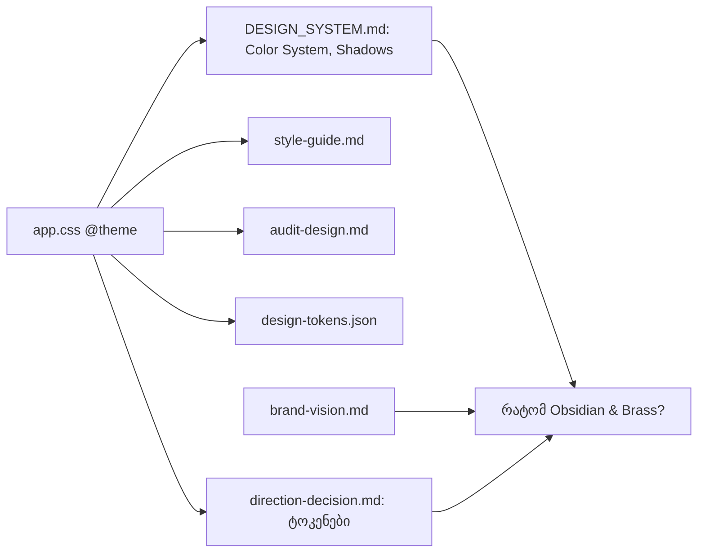

# DPG-P0-3b: დიზაინის reference დოკუმენტები Obsidian & Brass-ში

**თარიღი:** 2026-11-12
**სტატუსი:** Completed (C round 478 PASS)
**შეცვლილი პროექტი:** Store (მხოლოდ `docs/`: 11 ფაილი `docs/design`-ში, `direction-decision.md`, doc 307–309-ის სტატუსის ხაზი, ეს დოკუმენტი)

## კონტექსტი

DPG-FIX ბლოკის P0-ის მეოთხე პუნქტი (DPG-DOCS-UPDATE) და DPG-ის მეორე წესი: token-ის ცვლილება დოკუმენტაციის ცვლილებასაც ნიშნავს. STORE-2a-მ (doc 158) `app.css`-ის `@theme` Obsidian & Brass-ზე გადაიყვანა, P0-1…P0-3a-მ კი Store-იდან ძველი teal და გამოუცხადებელი token-ები მოაშორა, მაგრამ `docs/design`-ის reference დოკუმენტები ისევ ძველ ცივ-ლურჯ ფონებს, ძველ brand/accent ფერებს და `--shadow-glow`-ს აღწერდნენ. აგენტები ამ ფაილებიდან კოპირებენ მნიშვნელობებს, ამიტომ მოძველებული დოკუმენტი ახალ კოდში ძველ იდენტობას აბრუნებს.

`docs/technical/store-redesign/direction-decision.md` კი ასახელებდა `--color-obsidian-*` და `--color-brass-*` token-ებს, რომლებიც `app.css`-ში არ არსებობს.

## მიდგომა

მხოლოდ დოკუმენტები; `app/**` არ შეცვლილა. ყოველი „შემდეგ" მნიშვნელობა `app/styles/app.css`-ის `@theme`-დან არის აღებული.

B-ის გადაწყვეტილებები:

- **D-29z1692 — ოთხი კლასი.** hue-range სკანერმა `docs/design`-სა და `direction-decision.md`-ში 82 ხაზი იპოვა. თითოეული ერთ კლასს ეკუთვნის:
  1. ჩვენი მოძველებული token-ები და მითითებები → გადაწერა (55 ხაზი): `DESIGN_SYSTEM.md`, `style-guide.md`, `components/button.md`, `audit-design.md`, `design-tokens.json`, `box-render-specs.md` (l.110), `awwwards-improvements.md`.
  2. კონკურენტის ფაქტები → რჩება (`design-systems-reference.md`-ის SOUNDRAW-ის ხაზები).
  3. თარიღიანი გაზომვები და აუდიტები → ტექსტი რჩება, ემატება ბანერი: `wcag-audit.md`, `design-audit.md`, `star-brand-audit.md`, `design-systems-reference.md`. `wcag-audit.md`-ს ბოლოში ემატება ცოცხალი პალიტრის კონტრასტის სექცია (B-ის გამოთვლილი).
  4. ძველი იდენტობა არ არის → რჩება: `box-render-specs.md`-ის Gold ყუთის ფერები და `DESIGN_SYSTEM.md`-ის ვერსიის 2.1 ჩანაწერი.

  კლასები 2–4 არის 27 ხაზიანი განზრახ დარჩენილი სია.
- **D-29z1693 — რა რჩება ფარგლებს გარეთ.** ფონტები (DPG-FONT-RESOLVE), `--color-info` და error-ის წითლები (DPG-COLOR-CONSOLIDATE), `.claude/**` (root-ის მოთხოვნა ROOT-REQ-DPG-PRIMITIVES-PATCH) და `docs/design`-ის გარეთ არსებული 114 ხაზი (სიგნალი SIG-R477-DOCS-OUTSIDE-DESIGN, RETRO 480).
- **D-29z1694 — byte-equal sketch-ის ნაცვლად checker.** ქართული ტექსტი A-მ დაწერა; მნიშვნელობების სისწორეს ამოწმებს checker, რომელიც `app.css`-ს გაშვების დროს კითხულობს: (a) ყოველი `--color-*` / `--shadow-*` დეკლარაცია `@theme`-ის ტოლია; (b) ოთხ ნორმატიულ ფაილში ყოველი ფერის literal `app.css`-შია; (c) token-ის სახელიან ხაზზე ყოველი hex ამ token-ის მნიშვნელობაა.

`awwwards-improvements.md`-ის snippet-ები ფერით გადაკეთდა (`rgba(var(--color-brand-rgb), a)` იმავე alpha-თი), მაგრამ მათი glow-ის რჩევა ეწინააღმდეგება round 453-ის no-glow წესს. ეს გადადის DPG-INTERACTION-FIX-ში (P2) სიგნალად SIG-R478-AWWWARDS-GLOW; აქ არ წაშლილა.

## არქიტექტურა

`app.css` ერთადერთი წყაროა. „რატომ Obsidian & Brass?" სექციის ყოველი არგუმენტი `direction-decision.md`-ს ან `brand-vision.md`-ს ეყრდნობა.

## შეცვლილი ფაილები

- `docs/design/DESIGN_SYSTEM.md` — Color System და Shadows `@theme`-ის მიხედვით (brand-foreground, muted-bg, outline-strong, brand-rgb დამატებული; `--shadow-glow` ამოღებული; card/elevated ჩრდილები დამატებული); „რატომ Teal + Orange?" → „რატომ Obsidian & Brass?" წყაროებით; warm obsidian-ის ახსნა; Semantic ცხრილი, მაგალითები (Primary Button-ის hover-ზე `--shadow-glow` აღარ არის) და ვერსია 2.2.
- `docs/design/style-guide.md` — token-ების ცხრილი, 60-30-10, „Brass — ერთი თბილი აქცენტი", „Warm Obsidian Neutrals".
- `docs/design/components/button.md` — Primary/Accent ფონი `#C9A46A`; hover-ზე `shadow-glow` აღარ არის.
- `docs/design/audit-design.md` — ჩეკლისტი და სწრაფი რეფერენსი.
- `docs/design/design-tokens.json` — `color.*` და `shadow.*` `@theme`-ის ტოლია; `crystal.*`, `premium.*`, `shadow.glow`, `shadow.glow-accent` ამოღებულია.
- `docs/design/box-render-specs.md` — l.110: brass edge glow.
- `docs/design/awwwards-improvements.md` — l.71 და snippet-ების ფერი.
- `docs/design/design-audit.md`, `star-brand-audit.md`, `design-systems-reference.md` — მხოლოდ ბანერი (line 3).
- `docs/design/wcag-audit.md` — ბანერი და ცოცხალი პალიტრის კონტრასტის სექცია ბოლოში.
- `docs/technical/store-redesign/direction-decision.md` — მხოლოდ `@theme`-ში არსებული token-ების სახელები და მათი მნიშვნელობები.
- `docs/implementation/2026/quarter-IV/307-…`, `308-…`, `309-…` — სტატუსის ხაზი (l.4).
- ეს დოკუმენტი.

## პრობლემები და გადაწყვეტები

- **Problem:** `audit-design.md`-ის ჩეკლისტის ერთ ხაზზე სამი token-ის hex-ის ჩაწერა checker-ის name→value შემოწმებას არღვევს (ხაზზე ყოველი hex ყოველ დასახელებულ token-ს ედრება). → **Solution:** ტექსტისა და ფონის ხაზები token-ებს ასახელებს და მნიშვნელობებისთვის იმავე ფაილის სწრაფ რეფერენსს მიუთითებს; ხაზების რაოდენობა უცვლელია.
- **Problem:** ძველი hex-ის კომენტარში დატოვება (`/* #… */`) checker-ის literal შემოწმებას აწითლებს და მკითხველს ძველ მნიშვნელობას აჩვენებს. → **Solution:** დეკლარაციები პირდაპირ `@theme`-ის hex-ს იყენებს, კომენტარში მხოლოდ როლია.
- **Problem:** `docs/**` Tailwind-ის candidate-ების წყაროა. → **Solution:** დამატებულ ხაზებში arbitrary-value კლასი (კვადრატული ფრჩხილებით) არ არის; ფერები ჩაწერილია hex-ით, `var(--color-…)`-ით ან token-ის სახელით.

## ტესტირება

`docs/`-ს კოდი არ კითხულობს, ამიტომ vitest ფაილი ამ ცვლილებას არ ფარავს. A-მ გაუშვა:

- B-ის token checker: `FAILS 0` (HEAD-ზე 156).
- B-ის residual checker: `hits=27 residual=27 unexpected=0 residual_changed=0` (HEAD-ზე `unexpected=55`).
- round 478-ის claims script-ი (შედეგი `a-round-478/claims.txt`-შია).
- `design-tokens.json` ვალიდური JSON-ია.
- `npm run typecheck`.

C ამოწმებს checker-ების mutant-ებს, ექვსი token-ის მნიშვნელობას ბრაუზერის `getComputedStyle`-თან, WCAG-ის ათ თანაფარდობას და მთავარ გვერდს.

## TODO / შემდეგი ნაბიჯები

- **DP-gate re-review:** P0 დასრულდა; root ხელახლა უშვებს design-philosopher-სა და product-designer-ს.
- **ROOT-REQ-DPG-PRIMITIVES-PATCH:** `.claude/primitives/DESIGN_TOKENS.md` ისევ ძველ ფერებს აღწერს; root-მა DP gate-მდე უნდა შეასწოროს.
- **SIG-R478-AWWWARDS-GLOW:** glow-ის რჩევა `awwwards-improvements.md`-ში → DPG-INTERACTION-FIX (P2).
- **SIG-R477-DOCS-OUTSIDE-DESIGN:** `docs/design`-ის გარეთ დარჩენილი ძველი ფერები → RETRO 480.
- **DPG-FONT-RESOLVE, DPG-COLOR-CONSOLIDATE:** ფონტები, `--color-info` და error-ის ფერები (P1).
