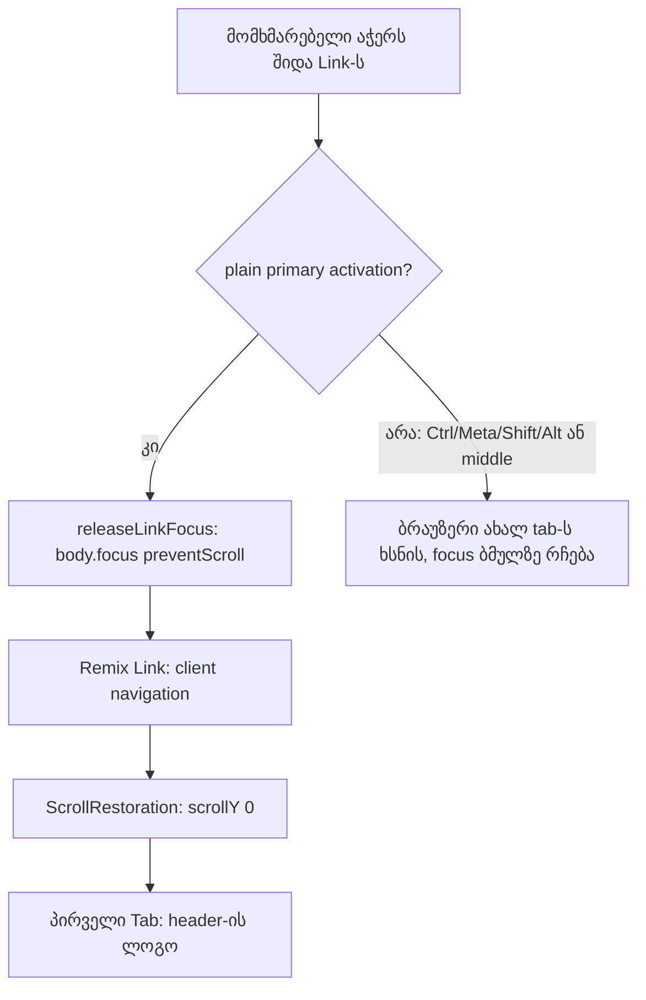

# DPG-FOOTER-LINKS: Store-ის შიდა ბმულები აპლიკაციის შიგნით გადადის

**თარიღი:** 2026-11-12
**სტატუსი:** Completed (C round 479 PASS)
**შეცვლილი პროექტი:** Store (6 source ფაილი, 1 ახალი helper, 4 ტესტის ფაილი, ეს დოკუმენტი)

## კონტექსტი

DPG-FIX ბლოკის P1-ის მესამე პუნქტი: „Footer.tsx-ში `<a>` შეიცვალოს `<Link>`-ით (full page reload კლავს premium შეგრძნებას)“. Footer-ის 9 ბმული ჩვეულებრივი `<a href>` იყო, ამიტომ ყოველი დაჭერა მთელ დოკუმენტს თავიდან ტვირთავდა: entrance cover, ფონტები და აპლიკაციის state თავიდან იტვირთებოდა. იგივე მიზეზი რამდენიმე სხვა შიდა ბმულსაც ჰქონდა, ამიტომ ფარგლები ამ მიზეზზე გაფართოვდა.

ეკრანზე არაფერი იცვლება: ტექსტი, კლასები და რიგი იგივეა. იცვლება მხოლოდ ელემენტის ტიპი (`Link`) და `onClick` handler.

## მიდგომა

**D-29z1697 — ფარგლები.** B-მ `app/**`-ის ყველა `<a` tag მთლიანი tag-ის parse-ით გადაამოწმა.

- **შედის:** Footer-ის 9 ბმული; `CookieConsent` → `/privacy`; მთავარი გვერდის `ProductSection` „View all“; `privacy.tsx` → `/cookies`; `terms.tsx` → `/license`; `faq.tsx` „Contact Us“ → `/hire-us`.
- **არ შედის:** `ErrorBoundary`-ის „/“ (full reload აქ შეცდომიდან აღდგენაა), `UserDropdown` (არსად import-დება), `SignUpForm` (auth modal ღია დარჩებოდა), `account.orders`-ის `/music` (არარსებული მისამართი), `account.downloads` (დაცული ფაილი), ყველა `mailto:` და `https:` ბმული.

**D-29z1698 — focus-ის კონტრაქტი.** client navigation დოკუმენტს ინარჩუნებს, ამიტომ Chrome sequential focus-ის საწყის წერტილად იმ ბმულს ტოვებს, რომელიც გაქრა. B-ის გაზომვით, footer „Support“-ზე Enter-ის შემდეგ პირველი Tab `/support` გვერდის „Live Chat“ ღილაკზე ხვდებოდა, HEAD-ზე (full reload) კი header-ის ლოგოზე. `blur()` ამას არ ასწორებს; `document.body`-ზე focus ასწორებს.

ამიტომ დაემატა საერთო helper `releaseLinkFocus` (`app/lib/link-focus.ts`):

- მუშაობს **მხოლოდ ჩვეულებრივ primary activation-ზე**: არც Ctrl, Meta, Shift, Alt, მხოლოდ მარცხენა ღილაკი, და event არ არის `defaultPrevented`;
- body-ს დროებით აძლევს `tabindex=-1`-ს (მხოლოდ თუ body-ს tabindex არ ჰქონდა), აკეთებს `focus({ preventScroll: true })`-ს და attribute-ს მაშინვე შლის;
- modifier click-ზე არაფერს აკეთებს: ბრაუზერი ახალ tab-ს ხსნის და focus ბმულზე რჩება, როგორც HEAD-ზე.

`app/lib/focus-source.ts`-ის დუბლიკატი არ არის: ის pointer და keyboard focus-ს არჩევს `:focus-visible`-სთვის.

**გამონაკლისი:** CookieConsent banner მუდმივად mount-ებულია და navigation-ზე არ ქრება, ამიტომ მის Privacy ბმულს helper არ აქვს; focus ბმულზე რჩება.

**D-29z1699 — ახალი findings.** footer-ის „License“ და Terms-ის ბმული `/license`-ზე გადადის, რომელსაც route არ აქვს (B-R478-DEAD-LICENSE-LINK, Medium, `awaiting_user`; Saba-ს კითხვა). ამ რაუნდში მისამართი არ იცვლება, ბმული მხოლოდ client-side ხდება. B-R478-DEAD-MUSIC-LINK (Medium) მოგვიანებით დაიგეგმება; B-R478-SOFT-404 (Low) გადადებულია.

**HEAD-ისგან განსხვავებები:**

1. დოკუმენტი აღარ იტვირთება თავიდან (პუნქტის მიზანი).
2. ახალი გვერდის სათაური screen reader-ს აღარ ეცნობება, რადგან reload აღარ ხდება. გამოსწორებას `root.tsx`-ში route announcer სჭირდება (root-ის ფაილი); ჩაწერილია SIG-R479-ROUTE-ANNOUNCE-ად.
3. მიმდინარე გვერდის ბმულზე დაჭერა გვერდს ზემოთ აბრუნებს, ნაცვლად reload-ისა და scroll-ის აღდგენისა.

## არქიტექტურა

## შეცვლილი ფაილები

- `app/lib/link-focus.ts` — ახალი helper `releaseLinkFocus`.
- `app/components/layout/Footer.tsx` — 9 `<a>` → `Link` helper-ით.
- `app/components/common/CookieConsent.tsx` — Privacy ბმული → `Link`, helper-ის გარეშე.
- `app/components/home/ProductSection.tsx` — „View all“ → `Link` helper-ით.
- `app/routes/privacy.tsx`, `app/routes/terms.tsx`, `app/routes/faq.tsx` — თითო შიდა ბმული → `Link` helper-ით; `mailto:` და `https:` ბმულები `<a>` რჩება.
- `app/lib/__tests__/link-focus.test.tsx` — ახალი (LF1–LF3).
- `app/lib/__tests__/store-internal-links.test.ts` — ახალი (IL1–IL4).
- `app/lib/__tests__/store-header-footer.test.tsx` — F1 ახლა `MemoryRouter`-ში render-დება, დაემატა F2 და F3.
- `app/components/common/__tests__/CookieConsent.test.tsx` — `@remix-run/react`-ის mock რეალურ მოდულს ინარჩუნებს და მხოლოდ `useLocation`-ს ცვლის; render `MemoryRouter`-ით; დაემატა CC6.

## პრობლემები და გადაწყვეტები

- **პრობლემა:** client navigation-ის შემდეგ პირველი Tab ახალი გვერდის შუაში ხვდებოდა. **გადაწყვეტა:** `releaseLinkFocus` focus-ს body-ზე გადაიტანს (D-29z1698).
- **პრობლემა:** helper-ის პირველი ვერსია Ctrl და middle click-ზეც მუშაობდა, რომლებიც მიმდინარე გვერდს არ ტოვებს. **გადაწყვეტა:** modifier და ღილაკის guard; LF3 ამოწმებს Ctrl, Meta, Shift, Alt და middle click-ს.
- **პრობლემა:** `Link` router-ის გარეშე ვერ render-დება, ამიტომ Footer-ისა და CookieConsent-ის ძველი ტესტები ჩავარდებოდა. **გადაწყვეტა:** ტესტები `MemoryRouter`-ში render-დება; F1 და CC1–CC5 ყველა ძველ assertion-ს ინარჩუნებს.

## ტესტირება

- LF1–LF3: helper focus-ს body-ზე გადაიტანს, არსებულ tabindex-ს ინარჩუნებს და modifier click-ზე არაფერს აკეთებს.
- IL1–IL4: 6 ფაილში შიდა `href`-იანი `<a>` აღარ არის; 4 მისამართს helper აქვს; scanner მრავალხაზიან tag-ს კითხულობს; CookieConsent-ის ბმულს helper არ აქვს.
- F2–F3: footer-ის 9 ბმული router-ის შიგნით გადადის, focus body-ზეა და tabindex არ რჩება; footer-ში ზუსტად 9 შიდა ბმულია.
- CC6: Privacy ბმული Remix `Link`-ია (`data-discover="true"`).
- A-მ გაუშვა `npm run typecheck`, `npm run lint` და 10 ფაილის 162 ტესტი; ყველა გავიდა. ბრაუზერის შემოწმება (scroll, focus, modifier click, cookie banner) C-ის რაუნდია.

## TODO / შემდეგი ნაბიჯები

- SIG-R479-ROUTE-ANNOUNCE: route announcer `root.tsx`-ში (root).
- B-R478-DEAD-LICENSE-LINK: `/license` გვერდი Saba-ს გადაწყვეტილებით.
- B-R478-DEAD-MUSIC-LINK: `account.orders`-ის `/music` ბმული.
- SIG-R479-AUTH-MODAL-LINKS და SIG-R479-USERDROPDOWN-DEAD: დანარჩენი `<a>` ბმულები.
