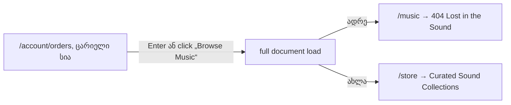

# B-R478-DEAD-MUSIC-LINK: My Orders-ის ცარიელი გვერდის „Browse Music“ ღილაკი კატალოგზე გადადის

**თარიღი:** 2026-11-12
**სტატუსი:** Completed (C round 481 PASS)
**შეცვლილი პროექტი:** Store (1 route ფაილი, 1 ახალი ტესტის ფაილი, ეს დოკუმენტი)

## კონტექსტი

შესული მყიდველი, რომელსაც შეკვეთები ჯერ არ აქვს, `/account/orders`-ზე ხედავს „No orders yet“ ტექსტს და brass ღილაკს „Browse Music“. ღილაკი `/music`-ზე მიდიოდა. ასეთი route არ არსებობს, ამიტომ მომხმარებელი 404 გვერდზე („Lost in the Sound“) ხვდებოდა. ეს არის Medium finding B-R478-DEAD-MUSIC-LINK-ის ის ნახევარი, რომელიც `account.orders.tsx`-ს ეხება.

იგივე მკვდარი ბმული აქვს `account.downloads.tsx`-ის ცარიელ მდგომარეობასაც. ის ფაილი დაცულია, ამიტომ ეს ნახევარი root-ს გადაეცა ROOT-REQ-DOWNLOADS-MUSIC-LINK-ით.

## მიდგომა

- **D-29z1709 (რიგი):** ეს ცვლილება რაუნდ 481-შია, finding-ის L46 deadline-ის ფარგლებში; შემდეგ მოდის REGRESSION-2026-11-13, CLIENT-NAV-CONTRACT და B-R480-ORDER-CARD-KEYBOARD.
- **D-29z1710 (ფარგლები):** იცვლება მხოლოდ `href`, `/music`-დან `/store`-ზე. ტექსტი „Browse Music“ რჩება (Saba-ს `questions-round-478.md` Q2-ში ეცნობა), კატეგორიის ფილტრი არ გამოიგონება. ელემენტი რჩება ჩვეულებრივ `<a>`-დ, ანუ full document load ხდება. Remix `<Link>` დაამატებდა კიდევ ერთ client navigation-ს, რომელსაც screen reader არ აცხადებს (GATE479-M1); ეს საკითხი CLIENT-NAV-CONTRACT-ს ეკუთვნის.
- **D-29z1711 (ახალი finding-ები):** B-R480-ORDER-CARD-KEYBOARD (Medium, რაუნდი 484), B-R480-SITEMAP-COLLECTIONS-MUSIC (Low, deferred) და SIG-R480-E2E-STALE-MUSIC-NAV (signal) ამ რაუნდში არ შედის.

კატეგორიის ფილტრი არ გამოიგონება: ბმული კატალოგის მთავარ გვერდზე (`/store`) მიდის.

## არქიტექტურა

## შეცვლილი ფაილები

- `app/routes/account.orders.tsx` — ცარიელი მდგომარეობის ბმულის `href` გახდა `/store`. კლასები, ტექსტი, ელემენტის ტიპი და import-ები უცვლელია.
- `app/lib/__tests__/account-orders-empty-state.test.tsx` (ახალი) — AO1 და AO2.
- `docs/implementation/2026/quarter-IV/312-dead-music-link-orders.md` (ახალი) — ეს დოკუმენტი.

## პრობლემები და გადაწყვეტები

- **პრობლემა:** finding-ის მეორე ნახევარი დაცულ `account.downloads.tsx`-შია. **გადაწყვეტა:** loop მას არ ეხება; root-ს გადაეცა ROOT-REQ-DOWNLOADS-MUSIC-LINK. ამიტომ B-R478-DEAD-MUSIC-LINK ამ რაუნდის შემდეგაც **ღიაა** და ელოდება დაცულ ნახევარს.
- **პრობლემა:** ტესტში `<Link>`-ზე გადასვლის mutant (M2) წითლდება მხოლოდ „useHref outside Router“ crash-ით. **გადაწყვეტა:** AO1-ის `data-discover` შემოწმება დამატებითი დაცვაა და ტესტის სათაური მას დამტკიცებულ შტოდ არ აცხადებს.

## ტესტირება

- **AO1:** ცარიელი სიისას „Browse Music“ ბმულის `href` არის `/store`, `data-discover` ატრიბუტი არ აქვს და `getMyOrders` გამოიძახება `(1, 50)`-ით.
- **AO2:** ცარიელ მდგომარეობაში ზუსტად ერთი ბმულია, `/store`.
- Mutant M1 (`href="/music"`) ორივე ტესტს assert-ზე აწითლებს (B-ის `mutant-M1-music-href.log`).
- `npm run typecheck`, `npm run lint` და AO ფაილის `vitest run` გაეშვა A-ს რაუნდში; ბრაუზერის შემოწმება (stubbed client path, 1440×900 და 1280×720) C-ის რაუნდ 481-შია.
- რეალური შეკვეთების მფლობელობა backend-ზეა დამოკიდებული და cloud-ში BLOCKED რჩება.

## TODO / შემდეგი ნაბიჯები

- ROOT-REQ-DOWNLOADS-MUSIC-LINK: `account.downloads.tsx`-ის ცარიელი მდგომარეობის ბმული (root, დაცული ფაილი).
- B-R480-ORDER-CARD-KEYBOARD: შეკვეთის ბარათები კლავიატურით (რაუნდი 484).
- CLIENT-NAV-CONTRACT: შიდა ნავიგაციის საერთო წესი (რაუნდი 483).
