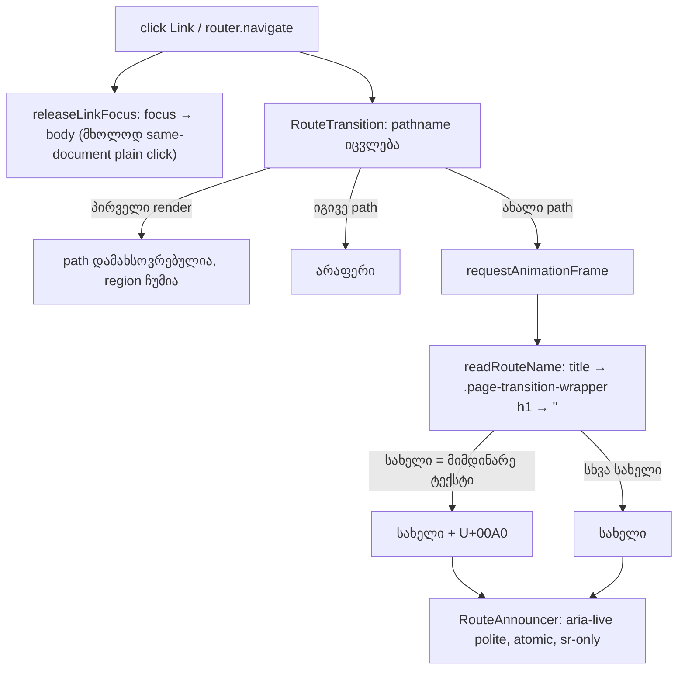

# CLIENT-NAV-CONTRACT: client navigation აცხადებს ახალ გვერდს, 6 Store route-ს აქვს title და releaseLinkFocus გამაგრებულია

**თარიღი:** 2026-11-13
**სტატუსი:** Completed (C round 485 PASS)
**შეცვლილი პროექტი:** Store (2 ახალი მოდული, 1 component, 1 lib ფაილი, 6 route, 3 ტესტის ფაილი, ეს დოკუმენტი)

## კონტექსტი

რაუნდ 479-დან Store-ის header, footer და content ბმულები Remix `<Link>`-ია, ანუ გვერდის შეცვლა client navigation-ით ხდება. full document load-ისას screen reader თავად აცხადებდა ახალი გვერდის `<title>`-ს; client navigation-ისას არაფერი ისმოდა. ეს არის Medium finding GATE479-M1-ROUTE-ANNOUNCE (gate reviewer).

ამასთან, 6 route-ს (`cart.tsx`, `search.tsx`, `account.tsx`, `account_.login.tsx`, `account.orders.tsx`, `account.reset.$id.$token.tsx`) `meta` export არ ჰქონდა: client navigation-ის შემდეგ `document.title` ცარიელი იყო, რაც WCAG 2.4.2 (Page Titled)-საც არღვევს.

იგივე systemic task (CLIENT-NAV-CONTRACT, D-29z1704) ხურავს ოთხ deferred Low-ს, რომლებსაც საერთო მიზეზი აქვთ:

- GATE479-L2-TABINDEX-FINALLY — `releaseLinkFocus`-ის დროებითი body `tabindex` არ იშლებოდა, თუ `focus()` exception-ს ისვრის;
- A-R479-L1-TARGET-BLANK — `target="_blank"` ან `download` ბმულზე focus მაინც body-ზე გადადიოდა, თუმცა მიმდინარე document არ იცვლება;
- A-R479-L3-DEFAULTPREVENTED-UNTESTED — `defaultPrevented` შტოს ტესტი არ ჰქონდა;
- A-R479-L2-SLOW-LOADER-FOCUS — ნელი loader-ის ქცევა დოკუმენტირებული არ იყო (იხურება ამ დოკუმენტით, იხ. ქვემოთ).

## მიდგომა

### Route announcer-ის კონტრაქტი

- **ადგილი:** `RouteTransition`. ის ყველა route-ს ახვევს (Store-საც და Studio-საც) და Studio ↔ Store გადასვლისას mount-ში რჩება. `app/root.tsx` დაცულია (`global_forbidden_files`), ხოლო `Header` `/studio*`-ზე არ რენდერდება, ამიტომ Header-ში region ყოველ Studio → Store გადასვლაზე თავიდან დამონტაჟდებოდა.
- **სახელის წყარო, რიგით** (`readRouteName`): ჯერ trimmed `document.title`, შემდეგ პირველი `.page-transition-wrapper h1`-ის trimmed ტექსტი, ბოლოს `''`. Next.js-ის route announcer-ისგან განსხვავებით raw pathname fallback არ არის: წარმოთქმული „/account/login“ გვერდის სახელი არ არის.
- **Region:** `
`, `role`-ის გარეშე. polite არ წყვეტს უკვე დაწყებულ საუბარს; `role="status"`-ის არქონა არსებულ `getByRole('status')` query-ებს არ ცვლის.
- **პირველი render ჩუმია:** effect-ის პირველი გაშვება მხოლოდ path-ს იმახსოვრებს. full load-ს ბრაუზერი თავად აცხადებს, ამიტომ ორმაგი განცხადება არ ხდება. StrictMode-ში effect-ის ორჯერ გაშვებაც ჩუმი რჩება.
- **იგივე path** (query ან hash-ის ცვლილება, re-render) არაფერს აცხადებს: გვერდი არ შეცვლილა.
- **ახალი path:** ერთი `requestAnimationFrame` კითხულობს სახელს ახალი გვერდის render-ის შემდეგ; cleanup აუქმებს მომლოდინე frame-ს, ამიტომ ერთ frame-ში ორი გადასვლიდან მხოლოდ ბოლო ცხადდება.
- **Repeat mark:** თუ ახალი სახელი region-ის მიმდინარე ტექსტს ემთხვევა (მაგ. `/account` → `/account/downloads`, ორივე „Account | CZABA“), ბოლოში ემატება U+00A0 (`String.fromCharCode(160)`), რომ region-ის ტექსტი შეიცვალოს და screen reader-მა ისევ წაიკითხოს. მესამე იგივე სახელი mark-ს ისევ აშორებს.
- **Studio ↔ Store:** ერთი region რჩება მთელი გზის განმავლობაში; Store → `/studio-lab` გადასვლაც ცხადდება („CZABA Studio — Demo collection“). `/studio/:productId` (დაცული `studio.$productId.tsx`) `meta`-ს არ აქვს და იქ გადასვლა ჩუმია: region `''`, თუმცა +4 წამზე wrapper-ში h1 „Sign in required“ უკვე ჩანს (A-ს probe `a-round-485/studio-product-probe.json`; h1 fallback-მა რატომ არ იმუშავა, დადგენილი არ არის); იხ. TODO.

### Route title-ები

ექვს loop-editable route-ს დაემატა `export const meta: MetaFunction = () => [{ title: … }]`, თითოეულს გვერდის საკუთარი h1 ტექსტი + ` | CZABA`:

| Route | Title |
|---|---|
| `cart.tsx` | Your Collection \| CZABA |
| `search.tsx` | Search \| CZABA |
| `account.tsx` | Account \| CZABA |
| `account_.login.tsx` | Sign In \| CZABA |
| `account.orders.tsx` | My Orders \| CZABA |
| `account.reset.$id.$token.tsx` | Reset Your Password \| CZABA |

h1-only fallback საკმარისი არ იყო: `/account/orders`-სა და `/account/reset/*`-ზე პირველი h1 არის `account.tsx` layout-ის „Account“, ამიტომ ეს გვერდები „Account“-ად გამოცხადდებოდა. h1 fallback safety net-ად რჩება. ანონიმურ `/account/*`-ზე გვერდი „Sign in required“-ს აჩვენებს, title კი route-ს ასახელებს — ეს მიღებულია: title ამბობს, სად არის მომხმარებელი.

### უარყოფილი მიდგომა: „ახალი გვერდი დამონტაჟდა“ სიგნალი `PageTransition`-ში

`PageTransition` თავის შიდა `motion.div`-ს `location.pathname`-ზე key-ავს. გასვლისას wrapper ხელახლა key-დება და ახალ route-ს აჩვენებს, ხოლო AnimatePresence-ის ახალი child mount-დება მხოლოდ **შემდეგ** ნავიგაციაზე (B-ის debug run: `b-round-484/probe/mount-signal-debug.txt`). mount-სიგნალი ერთი ნავიგაციით აგვიანებდა. ამიტომ გამოიყენება `pathname`-ზე effect + ერთი frame.

### `releaseLinkFocus`

- ბრუნდება ადრე, თუ anchor-ს `target` აქვს `''`/`_self`-ის გარდა სხვა მნიშვნელობით, ან `download` ატრიბუტი აქვს: ასეთი ბმული მიმდინარე document-ს არ ცვლის, ამიტომ focus ბმულზე რჩება.
- დროებითი body `tabindex` იშლება `finally`-ში, ანუ `focus()`-ის exception-ის დროსაც.
- **`reloadDocument` ფარგლებს გარეთაა:** ეს React Router-ის prop-ია და DOM ატრიბუტს არ ტოვებს, call site-ები მას არ იყენებენ, ხოლო full reload focus-ს ისედაც აბრუნებს.

### ნელი loader (ხურავს A-R479-L2-SLOW-LOADER-FOCUS)

focus click-ის მომენტში გადადის `<body>`-ზე. თუ loader ნელია ან ჩავარდება, focus ძველ გვერდზე `<body>`-ზე რჩება და შემდეგი Tab document-ის თავიდან იწყება. ეს მიღებულია: იგივე ხდება full reload-ისას.

## არქიტექტურა

## შეცვლილი ფაილები

- `app/components/animations/RouteAnnouncer.tsx` (ახალი) — visually hidden live region.
- `app/lib/route-name.ts` (ახალი) — `readRouteName(doc)`.
- `app/components/animations/RouteTransition.tsx` — region ორივე შტოში, `pathname` effect, repeat mark.
- `app/lib/link-focus.ts` — `target`/`download` guard და `finally`.
- `app/routes/cart.tsx`, `app/routes/search.tsx`, `app/routes/account.tsx`, `app/routes/account_.login.tsx`, `app/routes/account.orders.tsx`, `app/routes/account.reset.$id.$token.tsx` — `meta` title.
- `app/components/animations/__tests__/route-transition.test.tsx` — RA1–RA9 (RT1–RT4 უცვლელია).
- `app/lib/__tests__/route-name.test.ts` (ახალი) — RN1–RN3.
- `app/lib/__tests__/link-focus.test.tsx` — LF4–LF7 (LF1–LF3 უცვლელია).
- `docs/implementation/2026/quarter-IV/313-client-nav-contract.md` (ახალი) — ეს დოკუმენტი.

## პრობლემები და გადაწყვეტები

- **პრობლემა:** Header-ში region `/studio*`-დან დაბრუნებისას თავიდან დამონტაჟდებოდა. **გადაწყვეტა:** region `RouteTransition`-შია, რომელიც ორივე შტოში mount-ში რჩება (RA6).
- **პრობლემა:** ორ სხვადასხვა გვერდს შეიძლება ერთი სახელი ჰქონდეს, და იგივე ტექსტს live region ხელახლა არ კითხულობს. **გადაწყვეტა:** U+00A0 repeat mark (RA4).
- **პრობლემა:** title-ის გარეშე route-ები layout-ის h1-ით („Account“) გამოცხადდებოდა. **გადაწყვეტა:** 6 route-ს საკუთარი title აქვს.
- **პრობლემა:** `account.downloads.tsx` დაცულია და title-ს ვერ ვამატებთ. **გადაწყვეტა:** ის მშობელი route-ის „Account | CZABA“-ს იღებს; root-ის საქმეა (TODO ქვემოთ).
- **პრობლემა:** `focus()`-ის exception დროებით `tabindex`-ს body-ზე ტოვებდა. **გადაწყვეტა:** `finally` (LF7).

## ტესტირება

- **RA1** — ერთი polite, atomic, sr-only region, პირველ render-ზე ჩუმი.
- **RA2** — path-ის ცვლილება შემდეგი frame-ის შემდეგ აცხადებს ახალ `document.title`-ს.
- **RA3** — ცარიელი title-ისას ახალი გვერდის heading.
- **RA4** — ორი path ერთი სახელით: region-ის ტექსტი მაინც იცვლება (ზუსტი repeat ტექსტი).
- **RA5** — re-render იმავე path-ზე არაფერს აცხადებს.
- **RA6** — Studio → Store → Studio: იგივე region node, ორივე მისვლა ცხადდება.
- **RA7** — ერთ frame-ში ორი ცვლილება: ცხადდება მხოლოდ ბოლო გვერდი.
- **RA8** — StrictMode-ში პირველი render ჩუმია.
- **RA9** — Store ნავიგაცია `createMemoryRouter`-ით, ცარიელი title-ით, აცხადებს ახალი გვერდის heading-ს.
- **RN1–RN3** — title-ის უპირატესობა, wrapper-ის h1 fallback, ცარიელი სახელი.
- **LF3** — modifier/middle click focus-ს ბმულზე ტოვებს; **LF4** — `defaultPrevented` click focus-ს ბმულზე ტოვებს; **LF5** — `target="_blank"`, `target="_top"` და `download` ბმული focus-ს ინარჩუნებს; **LF6** — `target="_self"` focus-ს მაინც ათავისუფლებს; **LF7** — დროებითი `tabindex` იშლება, როცა `focus()` ისვრის.
- A-მ გაუშვა `npm run typecheck` (rc 0), `npm run lint` (rc 0) და 7 covering ტესტის ფაილი (93 ტესტი, ყველა PASS). ბრაუზერის შემოწმება (1440×900 და 1280×720, announce/repeat/extra probe-ები) C-ის რაუნდ 485-შია. სრული suite gate-ის საქმეა.

## TODO / შემდეგი ნაბიჯები

- **B-R485-DOWNLOADS-TITLE / ROOT-REQ-DOWNLOADS-TITLE:** `account.downloads.tsx` (დაცული) ახლა მშობლის „Account | CZABA“-ს იღებს. root-მა დაამატოს `title: 'My Downloads | CZABA'`.
- **`studio.$productId.tsx` title (დაცული, root):** route-ს `meta` არ აქვს, ამიტომ client navigation `/studio/:productId`-ზე არაფერს აცხადებს. root-მა დაამატოს title, სასურველია პროდუქტის სახელიდან.
- **TLM-R485-SR-ROUTE-ANNOUNCE:** რეალური NVDA/VoiceOver შემოწმება footer click-ის შემდეგ (Tech Lead, deadline RETRO 495).
- **B-R479-LEADMAGNET-TIMER-CLIENT-NAV:** ელოდება Saba-ს პასუხს (`questions-retro-480.md` Q2).
- **B-R480-ORDER-CARD-KEYBOARD:** შეკვეთის ბარათები კლავიატურით (რაუნდი 486).
