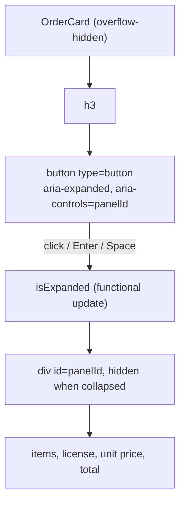

# B-R480-ORDER-CARD-KEYBOARD: My Orders-ის შეკვეთის ბარათი keyboard-ით და screen reader-ით იხსნება

**თარიღი:** 2026-11-13
**სტატუსი:** Completed (C round 486 PASS)
**შეცვლილი პროექტი:** Store (1 route, 1 ახალი ტესტის ფაილი, ეს დოკუმენტი)

## კონტექსტი

`/account/orders`-ზე თითო შეკვეთის ბარათის header იყო `
` მხოლოდ mouse click handler-ით. keyboard-ის და screen reader-ის მომხმარებელი ბარათს ვერ ხსნიდა და ვერ აღწევდა შეკვეთის item-ებამდე, license type-მდე და ფასებამდე. Biome ამას `lint/a11y/useKeyWithClickEvents`-ით აღნიშნავდა. B-მ ბრაუზერში დაადასტურა: 45-ნაბიჯიანი Tab walk-ში ბარათის შიგნით 0 Tab stop იყო. ეს იყო უძველესი ღია, loop-ით გამოსასწორებელი Medium finding (round 480).

## მიდგომა

გამოყენებულია WAI-ARIA APG-ის Accordion pattern (https://www.w3.org/WAI/ARIA/apg/patterns/accordion/, წაკითხულია 2026-11-13): თითო header `button` მოთავსებულია heading role-ის მქონე ელემენტში და heading-ში მხოლოდ ეს button არის.

- ბარათის header ახლა არის `<h3><button type="button">`. `h3` არსებული heading დონეა; პროექტში იგივე pattern-ს იყენებს `ProductAccordion.tsx` (`h2` > `button`).
- button-ს აქვს `aria-expanded` (true როცა panel ჩანს) და `aria-controls`, რომელიც panel-ის `useId`-ით შექმნილ id-ს ასახელებს. panel ყოველთვის რენდერდება და დახურულ მდგომარეობაში `hidden` attribute აქვს, ამიტომ `aria-controls` ყოველთვის რეალურ ელემენტზე მიუთითებს.
- Enter და Space native button-ის ქცევით ცვლის მდგომარეობას. თითო ბარათი დამოუკიდებლად იხსნება (რამდენიმე შეიძლება ერთდროულად იყოს ღია, როგორც ადრე).
- **რატომ არა `role="region"`:** APG გვირჩევს region-ს მოვერიდოთ, როცა ბევრი panel შეიძლება ერთდროულად იყოს ღია და landmark-ები გამრავლდება. გვერდი 50-მდე შეკვეთას ტვირთავს, ამიტომ region არ გამოიყენება.
- button-ის შიგნით ყველა ელემენტი `span`-ია იმავე class-ებით, რაც ჩანაცვლებულ ელემენტს ჰქონდა (button-ში `div`/`h3` არავალიდური HTML-ია).
- **რატომ არის ring შიგნით (inset):** ბარათს აქვს `overflow-hidden`, ამიტომ გარეთა outline სამ მხარეს მოიჭრებოდა. საერთო `:focus-visible` წესი რჩება ერთადერთ ring-ად; მხოლოდ მისი offset გადადის შიგნით არსებული `--focus-offset` hook-ით (`[--focus-offset:-2px]`). ახალი focus utility class არ დამატებულა.
- **რატომ არ აქვს button-ს radius:** მიზანი იყო, რომ ბარათი HEAD-ისგან 0 px-ით არ განსხვავდებოდეს მოსვენებულ, hover და გახსნილ მდგომარეობაში. radius-ის მოხსნით B-მ ეს 0-px diff მიიღო; `block`-ის გარდა სხვა display-ის, radius-ის ან focus class-ის დამატება აკრძალულია.
- **მიღებული side effect-ები:**
  - `h3`-ის accessible name ახლა მოიცავს status-ს, თარიღს, ფასს და item-ების რაოდენობას (APG-ში heading button-ს შეიცავს); შეკვეთის ნომერი პირველია.
  - გლობალური `button:active` 0.98 scale ამ button-ზე `active:transform-none!`-ით უქმდება, ხოლო `select-text` აბრუნებს HEAD-ის ქცევას: drag-ით "Order #1001"-ის მონიშვნა. ორივეს C round 486-ის browser row-ები OC-PRESS და OC-SELECT ამოწმებს (B-ის v1 browser mutant-ით). ეს რაუნდის მტკიცებულებაა და არა repo-ში შენახული regression ტესტი: OC1–OC4 ამ class-ებს არ ამოწმებს. ეს `ProductAccordion`-ისგან შეგნებული განსხვავებაა: ბარათის header მთლიანი ჩანაწერია, რომლის ნომრის მონიშვნაც მომხმარებელს შეიძლება დასჭირდეს.
  - Held key: native button-ის ქცევა (B-ის sketch-ზე Enter ყოველ repeat-ზე ცვლის, Space ერთხელ; C ამას OC-HELD-STUBBED-ში აფიქსირებს).
  - დახურული panel-ის შიგთავსი DOM-შია (focusable ელემენტი შიგნით არ არის). find-in-page დახურულ item-ებს ვერ პოულობს; HEAD-ზე ისინი საერთოდ არ რენდერდებოდა.
  - 50-მდე ბარათი ნიშნავს 50-მდე დამატებით Tab stop-ს; ეს pattern-ის თვისებაა.

## არქიტექტურა

## შეცვლილი ფაილები

- `app/routes/account.orders.tsx` — `OrderCard`-ის header გადაკეთდა `h3 > button` disclosure-ად; panel ყოველთვის რენდერდება `hidden`-ით; `useId` დაემატა React import-ს.
- `app/lib/__tests__/account-orders-card.test.tsx` (ახალი) — OC1–OC4 unit ტესტები.
- `docs/implementation/2026/quarter-IV/314-order-card-keyboard.md` — ეს დოკუმენტი.

## პრობლემები და გადაწყვეტები

- **პრობლემა:** `<button>` ბლოკავს ტექსტის მონიშვნას და გლობალური `button:active` წესი მას 0.98-ზე ამცირებს (v1 browser mutant: drag selection ცარიელია, pressed `matrix(0.98…)`). → **გადაწყვეტა:** `select-text` და `active:transform-none!` (important utility სჯობს unlayered ჩვეულებრივ წესს; გაზომილი `none`).
- **პრობლემა:** გარეთა focus ring `overflow-hidden` ბარათში იჭრებოდა. → **გადაწყვეტა:** `[--focus-offset:-2px]` არსებული hook-ით, ახალი class-ის გარეშე.
- **პრობლემა:** button-ის radius-ით screenshot HEAD-ს არ ემთხვეოდა. → **გადაწყვეტა:** radius არ აქვს; OC-PIXEL 0 px-ს მოითხოვს.

## ტესტირება

- Unit (`account-orders-card.test.tsx`):
  - OC1 — header არის native `type=button` თავის `h3`-ში, დახურული, აკონტროლებს hidden panel-ს; `role="button"` ელემენტი არ არის.
  - OC2 — click აჩენს item-ის heading-ს, variant-ს, license-ს, unit price-ს და total-ს panel-ში; მეორე click მალავს.
  - OC3 — ორი ბარათი სხვადასხვა panel-ს აკონტროლებს და დამოუკიდებლად იხსნება.
  - OC4 — toggle node და focus გადარჩება გახსნა-დახურვას. ეს jsdom ტესტია და მხოლოდ "remount არ ხდება"-ს ამოწმებს; რეალური keyboard focus-ს ამოწმებს browser row-ები OC-KEYS-STUBBED და OC-TAB-STUBBED (C round 486).
- A-ს გაშვებები: `npm run typecheck` rc 0, `npm run lint` rc 0, scoped Biome — 1 წინასწარ არსებული `noArrayIndexKey` warning loading skeleton-ში, 5 covering ტესტის ფაილი — 68 passed.
- Browser (C round 486): Tab walk, Enter/Space, held keys, ring, pixel diff, box, mouse, press, selection, aria snapshot; ყველა stubbed backend-ით, ანუ მხოლოდ client path. რეალური backend-ის შეკვეთები cloud-ში მიუწვდომელია.

## TODO / შემდეგი ნაბიჯები

- TODO: B-R486-FOCUS-OFFSET-GUARD (Low, deferred) — საერთო `:focus-visible` წესის `--focus-offset` hook Store component-ში პირველად გამოიყენება; `store-focus-ring.test.ts`-ს მისთვის allow-list არ აქვს, ამიტომ ნებისმიერი offset შეიძლება გადაიწეროს. გამოსწორება: hook-ის დოკუმენტირება როგორც დამტკიცებული offset-ის (DESIGN_TOKENS, root-ის გავლით) და allow-list row `store-focus-ring.test.ts`-ში.
- რეალური backend-ის შეკვეთებით შემოწმება (OWN-BACKEND), როცა backend ხელმისაწვდომი იქნება.
- შემდეგი რაუნდი: B-R486-PROFILE-NAME-KEYBOARD.
