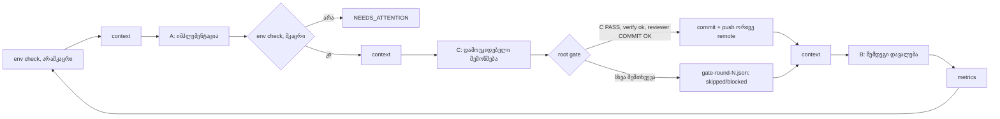

# Loop v2: CZABA Studio-ს აგენტების ლუპის მეორე ვერსია

**თარიღი:** 2026-10-19 · **ავტორი:** root (Claude) · **სტატუსი:** მზადაა გადასართავად (`switch-to-v2.cmd`)

## რატომ

კარპათის „Software 3.0“ ლოგიკით ლუპი სამი ნაწილისგან შედგება: **LLM-აგენტები** (B/A/C), **მეხსიერება** (backlog, ანგარიშები) და **graph**, რომელიც მათ აერთებს. v1-ში graph მხოლოდ `B → A → C`-ს ციკლი იყო. ყველაფერი დანარჩენი ადამიანის ან root-ის ხელით კეთდებოდა და 2026-10-15–19-ში სწორედ ეს ჩავარდა:

| რა მოხდა v1-ში | რეალური ზარალი | v2-ის კვანძი |
|---|---|---|
| A-ს ქსელი გაუწყდა (`ENOTFOUND`), შემდეგ კი session limit (429) | ლუპი გაჩერდა და ხელით გადატვირთვა დასჭირდა (r47, r60, r62) | **retry**: limit-ზე ელოდება reset-ის დრომდე, ქსელზე backoff-ია 2/5/10/20 წთ |
| `:5173`/`:5199` გაითიშა | C-მ 7+ რაუნდი ბრაუზერის გარეშე, „offline“ PASS მისცა | **env check**: C-მდე ამოწმებს და რესტარტავს, თუ ვერ აღადგენს — `NEEDS_ATTENTION` |
| root-ის commit/push graph-ის გარეთ იყო | 50–63 რაუნდები დაუკომიტებლად დაგროვდა | **root gate**: C PASS → verify → code-reviewer → commit → push ორივე remote-ზე |
| pwsh აღარ იყო, PowerShell 5.1-ის stdin ASCII-ა | `agent-workflow.md`-ის ქართული წესები აგენტებამდე `????`-ად მიდიოდა | UTF-8 stdin (`$OutputEncoding`) |
| watchdog `pwsh`-ს იძახებდა | კონტექსტის ზღვარზე რესტარტი ვეღარ ხდებოდა | `watch-context-v2.py`: pwsh ან powershell |
| ყოველი აგენტი კითხულობდა 564KB backlog-ს | ძვირი, ნელი, ზედმეტი ისტორია კონტექსტში | **context node**: `context/active-backlog.json` (~100KB) და `active-summary.md` |
| არ ჩანდა, რა ღირს რაუნდი და რამდენი ბაგი მოდის | ხარისხის და ხარჯის ტრენდი უცნობი | **metrics**: `loop-v2/metrics/summary.md`, `rounds.csv` |
| `-RoundLimit 64` | 64-ზე ჩუმად გაჩერდებოდა | 999 |

## როგორ მუშაობს

ყოველი აგენტის გამოძახება (A, B, C და gate-ის reviewer) გადის `Invoke-ClaudeJson`-ში:
- **ok** → შედეგი;
- **limit** (429, „session limit … resets 10:10pm“) → სტატუსი `WAITING_LIMIT`, ლოდინი reset-მდე +3 წთ (მაქს. 6 სთ), შემდეგ **იმავე ფაზის** ხელახალი გაშვება „ROOT RESUME NOTE“-ით: ნაწილობრივი ნამუშევარი შეინახე, არ გაიმეორო;
- **transient** (ქსელი, 5xx, overloaded) → 4 ცდა backoff-ით;
- სხვა შეცდომაზე ლუპი ჩერდება.
ყოველი ჩავარდნილი მცდელობა ინახება როგორც `*-result.json.attemptN.json`.

**Root gate** commit-ს მხოლოდ მაშინ აკეთებს, როცა ყველა პირობა სრულდება:
1. `c-round-N.json` = PASS და critical/high ბაგი არ არის;
2. რეალური ცვლილებები არსებობს: CRLF-ის მხოლოდ სხვაობა იგნორირდება (`git diff --ignore-cr-at-eol`);
3. protected ფაილი (`studio.$productId.tsx`, `api.studio-token.ts`, `account.downloads.tsx`, `download-routes.test.ts`) არ შეცვლილა;
4. `npm run verify` = 0;
5. დამოუკიდებელი `code-reviewer` აბრუნებს `COMMIT: OK`.
ამის შემდეგ: `git add` მხოლოდ ამ ფაილებზე → commit → `git push origin master` → `ls-remote` ორივე მისამართზე → `publication-checkpoint.json` და `loop-v2/publications.jsonl`. reviewer-ის შენიშვნები B-სთვის `root-pre-push-review.md`-ში ჩაიწერება.

აგენტებს **`git commit`/`git push` აკრძალული აქვთ** (`--disallowedTools`). publish მხოლოდ gate-ს შეუძლია.

## ფაილები

| ფაილი | რას აკეთებს |
|---|---|
| `run-loop-v2.ps1` | graph (PowerShell 5.1-თან თავსებადი); prompt-ები v1-ის ტექსტია, დამატებული v2 წესებით |
| `build-context.mjs` | backlog-ის აქტიური ხედი: ღია findings, მიმდინარე SRW სრულად, დანარჩენი მოკლედ, ბოლო 3 რაუნდი |
| `loop-metrics.mjs` | ხარჯი, დრო, შეცდომები, C-ის ვერდიქტები, ბაგები severity-ით, ბრაუზერის დაფარვა, gate |
| `watch-context-v2.py` | კონტექსტის watchdog (650k), რესტარტავს v2-ს |
| `switch-to-v2.ps1` / `.cmd` | ერთჯერადი გადართვა შემდეგ C → B საზღვარზე |

**გადართვა:** გაუშვი `switch-to-v2.cmd` (ორჯერ დაწკაპუნებით). ის ელოდება, სანამ ახლანდელი რაუნდის C დასრულდება, შემდეგ: v1 და ძველი watchdog ჩერდება, `cb12805`-ის ძველი bundle აღარ გამოიყენება (gate HEAD-ის შემდეგ ყველაფერს ერთად აქვეყნებს), იწყება watchdog v2, ლუპი v2 კი გრძელდება იმავე რაუნდის **root gate**-იდან. შედეგი ჩანს `loop-v2/switch.log`-ში და `status.json`-ში (`"runner": "v2"`).

**ტესტირება:** cloud-ში pwsh 7.4-ით, ყალბი `claude` CLI-ით:
- limit → ლოდინი → resume note → წარმატება;
- ორი რაუნდი publish → COMPLETE-ზე გაჩერება;
- C FAIL → gate `skipped`;
- reviewer BLOCK → `blocked`;
- protected ფაილი → `blocked`;
- CRLF-ის მხოლოდ ცვლილება commit-ში არ მოხვდა;
- ქართული ტექსტი აგენტამდე უცვლელად მივიდა.

რეალურ Windows PowerShell 5.1-ზე პირველი გაშვება სწორედ გადართვაა, ამიტომ პირველ საათში `loop-v2/loop-v2.log` უნდა მოწმდებოდეს.

## სხვა პროექტებში გამოყენება

ეს ნიმუში CZABA-ზე დამოკიდებული არ არის. ნებისმიერ პროექტში (Terabank-ის სერვისი, Lavini-ს საიტი, reminder app) ხუთი ნაწილი გჭირდება:

1. **როლები გამიჯნული უფლებებით.** დამგეგმავი წერს მხოლოდ დავალებას, შემსრულებელი ცვლის მხოლოდ ნებადართულ ფაილებს, შემმოწმებელი მხოლოდ კითხულობს და ანგარიშს წერს, publish-ი კი მხოლოდ root-ის საქმეა. წესი: „ვინც წერს, ის არ ამოწმებს“.
2. **ფაილებზე დაფუძნებული მეხსიერება.** `current-task.md`, `backlog.json`, `<role>-round-N.md/.json`, checkpoint-ები. აგენტის სესია ქრება, ფაილები რჩება. დიდი ისტორია აქტიურ ხედად იჭრება.
3. **მკაცრი კონტრაქტი.** B-ს დავალებაში წერია ზუსტი ownership, მიღების ID-ები, frozen ფაილები და hash-ები. C-ის JSON სქემა `taskStatus/bugs/passed/blocked/browserVerified`-ია. ამის გარეშე LLM „დამაჯერებლად ჟღერს“, მაგრამ შემოწმებადი არაფერია.
4. **Graph-ის კვანძები ინფრასტრუქტურისთვის.** env check, retry/backoff, gate/publish, metrics. ეს ჩვეულებრივი დეტერმინისტული Software 1.0-ია და LLM-ს არ ანდობ.
5. **Eval-ები ლუპისთვის.** ხარჯი/რაუნდი, PASS rate, C-ის ნაპოვნი ბაგები, რეალური შემოწმების დაფარვა. გაზომვის გარეშე არ იცი, ლუპი უმჯობესდება თუ ფულს წვავს.

.NET-ის სამყაროში იგივე სტრუქტურა ასე გამოიყურება: B = backlog/PR description-ის ავტორი, A = feature branch-ის დეველოპერი, C = QA, რომელიც `dotnet test`-ს და integration-ს თავიდან უშვებს, root gate = CI pipeline (build, tests, review, merge). ლუპი, ფაქტობრივად, CI/CD-ია, სადაც დეველოპერიც და QA-ც აგენტია.
